<div align="center">
  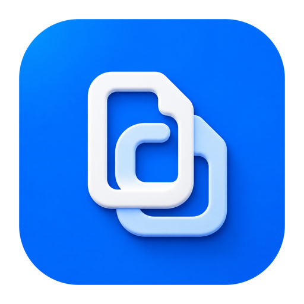
  <h1>Clipy</h1>
  <p><b>Clipboard history · encrypted LAN sync · screenshots & OCR</b><br />macOS · Windows · Android</p>
  <p><strong>English</strong> · <a href="README_ZH.md">简体中文</a></p>

[](https://github.com/JunWeiUp/Clipy/releases)
[](https://github.com/JunWeiUp/Clipy/actions/workflows/ci.yml)
[](LICENSE.GPL-3.0) [](LICENSE)

  

**[⬇ Download the latest release](https://github.com/JunWeiUp/Clipy/releases/latest)**<br />
<sub>macOS 13+ (Apple Silicon) · Windows 10/11 x64 · Android 8.0+ arm64</sub>

</div>

## Mac

<table>
<tr>
<td align="center" valign="top" width="50%">
<b>Menu bar panel</b><br /><sub>Search, recent copies, snippets and devices</sub><br /><br />
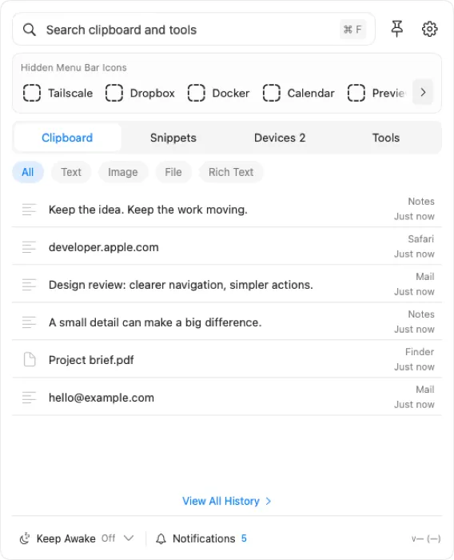
</td>
<td align="center" valign="top" width="50%">
<b>Clipboard history</b><br /><sub>Filter by type, app or date, with a full preview</sub><br /><br />
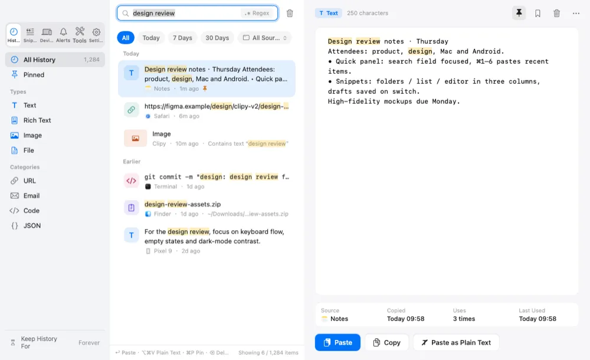
<br /><br />
<b>Snippets</b><br /><sub>Folders, search and global hotkeys</sub><br /><br />
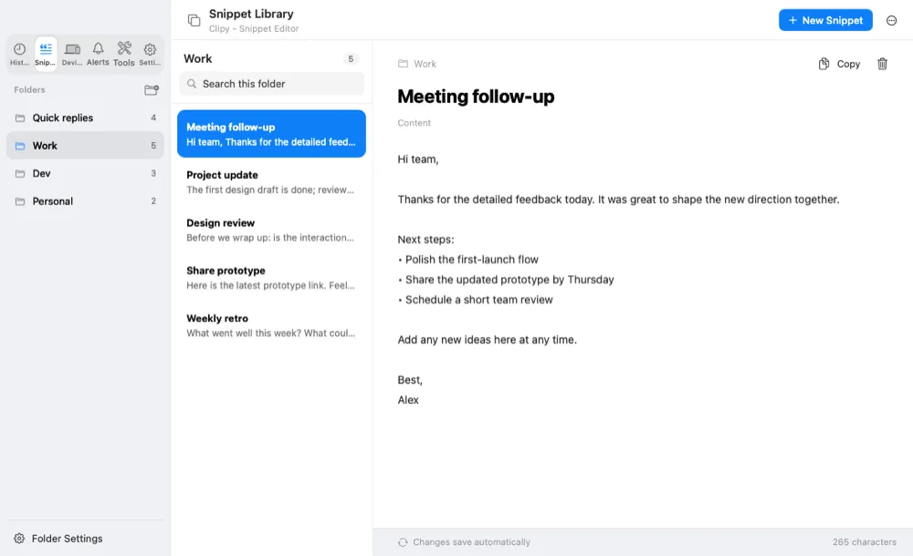
</td>
</tr>
<tr>
<td align="center" valign="top">
<b>Screenshots & annotation</b><br /><sub>Draggable control island, 18 tools</sub><br /><br />
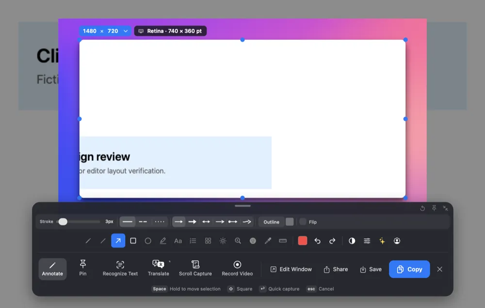
</td>
<td align="center" valign="top">
<b>Text & QR recognition</b><br /><sub>On-device OCR</sub><br /><br />
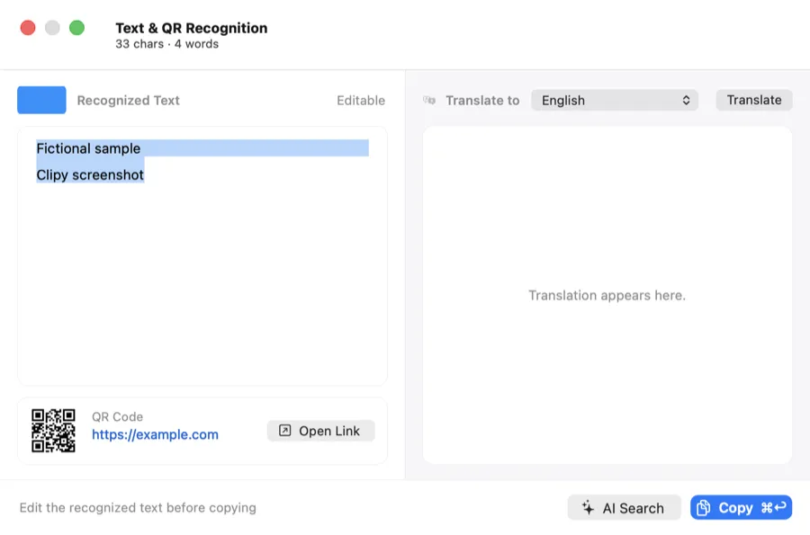
</td>
</tr>
<tr>
<td align="center" valign="top">
<b>Devices</b><br /><sub>LAN discovery, send text and files</sub><br /><br />
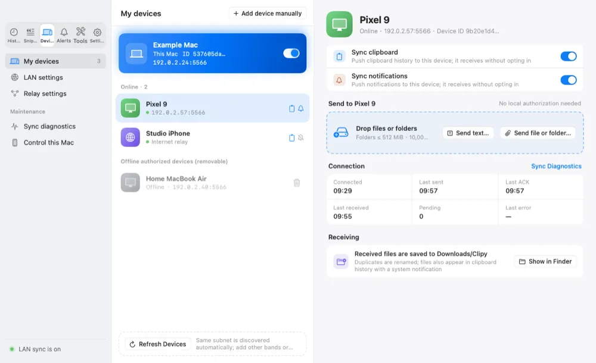
</td>
<td align="center" valign="top">
<b>Phone notifications</b><br /><sub>Android notifications on your Mac</sub><br /><br />
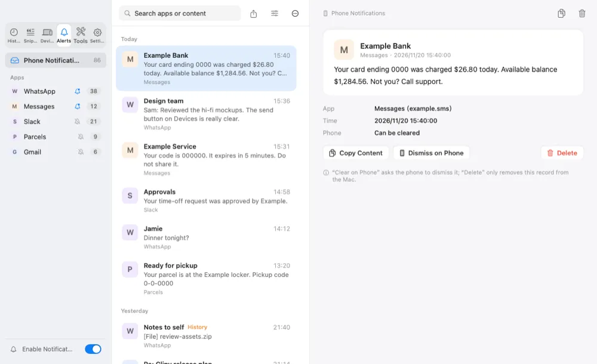
</td>
</tr>
<tr>
<td align="center" valign="top">
<b>Dictionary & vocabulary</b><br /><sub>Look up words, translate sentences</sub><br /><br />
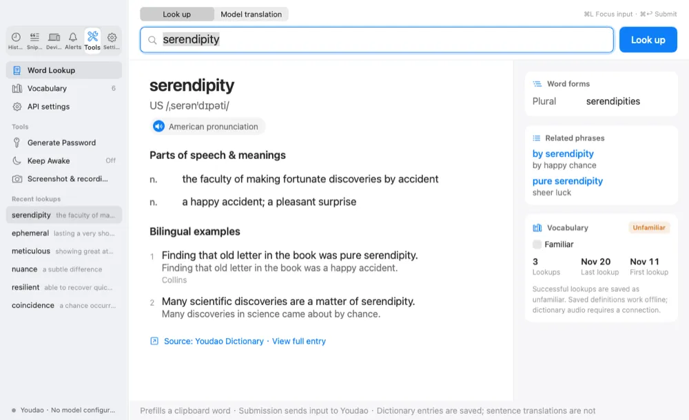
</td>
<td align="center" valign="top">
<b>Keep Awake</b><br /><sub>Prevent idle sleep for a set time</sub><br /><br />
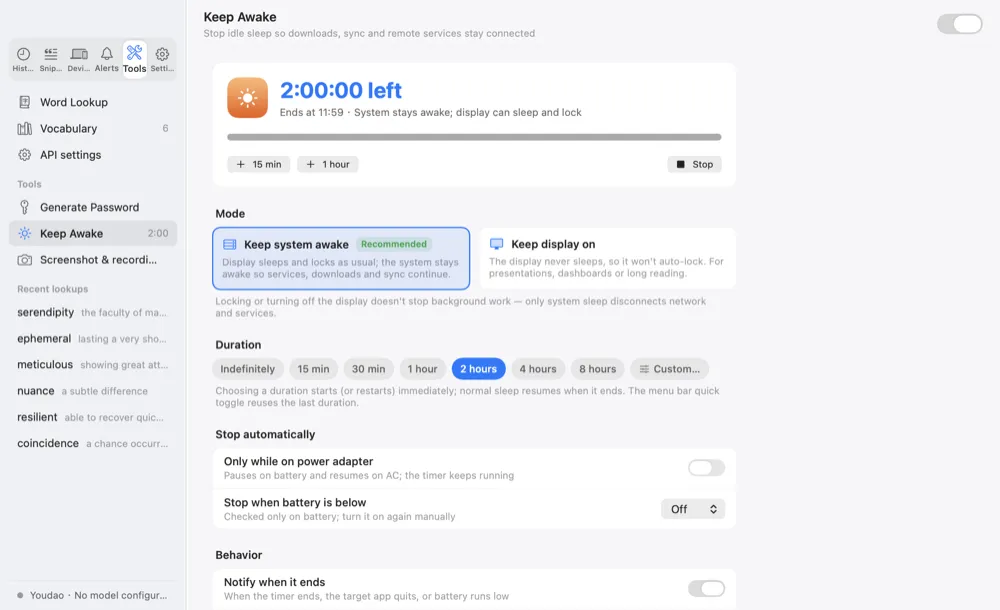
</td>
</tr>
</table>

## Android

<p align="center">
  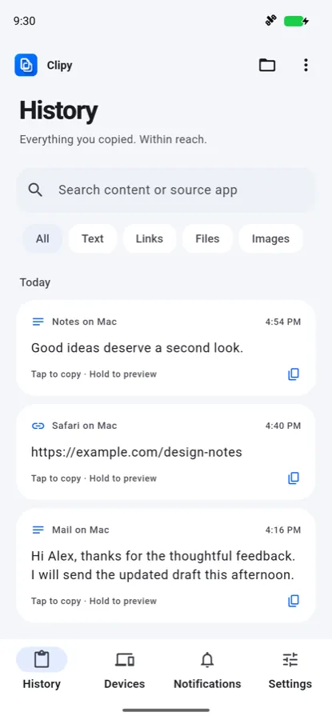&nbsp;&nbsp;
  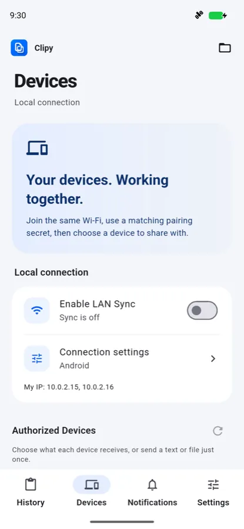&nbsp;&nbsp;
  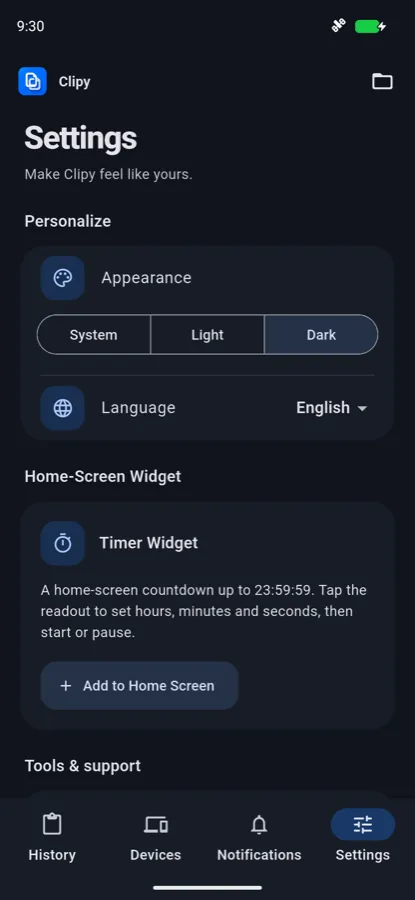
</p>
<p align="center"><sub>History · Devices · Settings, plus notification forwarding and a countdown widget</sub></p>

<sub>Screenshots use fictional sample data and show the current source build. The header is a concept illustration. [Production notes](res/screenshots/README.md)</sub>

## Platforms

| | macOS | Windows | Android | iOS |
| --- | :---: | :---: | :---: | :---: |
| Clipboard history & search | ✅ | ✅ | ✅ | ✅ |
| Encrypted LAN text sync | ✅ | ✅ | ✅ | foreground |
| File transfer | ✅ | ✅ | ✅ | ✅ |
| Phone notifications | ✅ | view | forward | view |
| Snippets & hotkeys | ✅ | | | |
| Screenshots, OCR, recording | ✅ | screenshots | | |
| Dictionary, Keep Awake | ✅ | | | |
| Package | ZIP | ZIP | APK | source only |

## Get started

1. **Install** — move the Mac app to Applications, extract the Windows ZIP, or install the Android APK.
2. **Copy** — on Mac, press <kbd>⇧</kbd> <kbd>⌘</kbd> <kbd>F</kbd> to search history.
3. **Connect** — put devices on the same trusted Wi-Fi, then refresh the device list.

[Report a problem](https://github.com/JunWeiUp/Clipy/issues/new?template=bug_report.yml) · [Suggest a feature](https://github.com/JunWeiUp/Clipy/issues/new?template=feature_request.yml)

> [!NOTE]
> LAN sync is meant for trusted networks. The current source uses a built-in default AES-GCM key, which does not authenticate devices. See [SECURITY.md](SECURITY.md).

Current source version: **1.0.43** · Source build **12390** (Android arm64 `versionCode` **14390**) · Latest published release: **[v1.0.43](https://github.com/JunWeiUp/Clipy/releases/tag/v1.0.43)**

<details>
<summary><b>All features</b></summary>

- **History** — macOS keeps text, RTF, HTML, PDF, images and files; Windows keeps text, images and file paths. Duplicates move to the top. You can exclude apps, set retention, and optionally encrypt stored media.
- **Snippets (Mac)** — folders, drag-to-reorder, per-snippet global hotkeys, XML import/export.
- **Screenshots (Mac)** — region, window, fullscreen, scrolling capture and screen recording (MP4/GIF). Includes 18 annotation tools, beautify, OCR, QR, auto-redact, translation, pin to screen and an editor window. Based on [macshot](https://github.com/sw33tLie/macshot).
- **Search (Mac)** — <kbd>⇧</kbd> <kbd>⌘</kbd> <kbd>F</kbd>, with regex and filters by type, app and date.
- **Dictionary (Mac)** — <kbd>⌃</kbd> <kbd>⌥</kbd> <kbd>D</kbd>. Chinese ↔ English lookup, sentence translation, optional model translation through your own API, and an offline vocabulary book.
- **Sync** — AES-GCM over the LAN using `/24` scan or manual `IP:port`, with ACKs and an offline queue. Text syncs automatically; files are sent explicitly (up to 1 GiB each; Mac-to-Mac folders supported). An optional self-hosted [common-relay](https://github.com/JunWeiUp/common-relay) adds Internet fallback.
- **Notifications** — forward selected Android apps to the desktop. On macOS, dismissals sync both ways.
- **Keep Awake (Mac)** — system or display mode, timed or until an app quits. Can pause on battery; released on quit.
- **Interface** — one Mac main window (<kbd>⌥</kbd> <kbd>⌘</kbd> <kbd>1</kbd>–<kbd>6</kbd>), light/dark, Chinese/English. Windows runs in the system tray.

</details>

<details>
<summary><b>Build from source</b></summary>

**macOS** (Xcode 26+, deployment target macOS 13)

```bash
./build_macos_app.sh                         # → clipy_macos/ClipyClone.app (ad-hoc signed)
INSTALL_APP=1 LAUNCH_APP=1 ./build_macos_app.sh
```

**Android** (Flutter 3.41.7, JDK 17; configure a release keystore first)

```bash
./build_android_apk.sh                       # → dist/ClipyClone-Android-*.apk
```

**Windows** (Flutter 3.41.7 + Visual Studio C++ workload)

```powershell
cd clipy_flutter
flutter pub get --enforce-lockfile
flutter build windows --release --no-pub -t lib/main_windows.dart
cd ..
./scripts/package_windows.ps1 -Version 1.0.43
```

**iOS** — the iOS 15+ target builds unsigned in CI. Installing on a device requires your own signing.

**Checks** — `bash scripts/check.sh all`; on macOS also run `bash scripts/test_macos_core.sh`.

The version comes from `version: X.Y.Z+N` in [`clipy_flutter/pubspec.yaml`](clipy_flutter/pubspec.yaml); Android `versionCode` = N + 2000. Pushing a new tag `vX.Y.Z` publishes a release with the three packages. See [Releases](https://github.com/JunWeiUp/Clipy/releases) for per-version changes.

**Layout** — `clipy_macos/` is the Swift/AppKit Mac app. `clipy_flutter/` holds the Android, Windows and iOS apps. `clipy_macos_nsh_experimental/` is a paused experiment that is not built. `packages/relay-swift/` is the relay dependency. `scripts/` has build and check tools.

</details>

## Contributing

Issues and pull requests are welcome in English or Chinese. See [CONTRIBUTING.md](CONTRIBUTING.md).

## License

Clipy-authored code is [MIT](LICENSE). The macOS app includes modified macshot code and is distributed under [GPLv3](LICENSE.GPL-3.0); Android and Windows do not include it. See [THIRD_PARTY_NOTICES.md](THIRD_PARTY_NOTICES.md).

[](https://star-history.com/#JunWeiUp/Clipy&Date)
