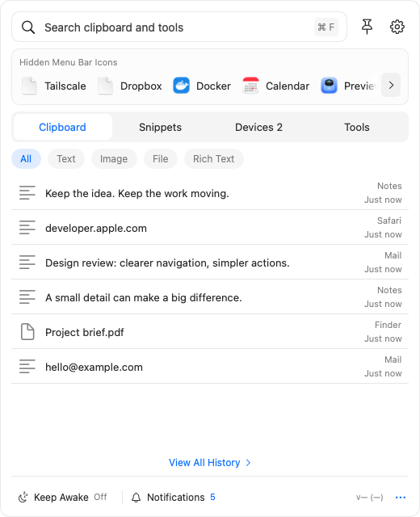

<div align="center">
  
  <h1>Clipy</h1>
  <h3>Clipboard history, encrypted LAN sync, screenshots and OCR.</h3>
  <p>An open-source clipboard manager for macOS, Windows and Android.</p>
  <p><strong>English</strong> · <a href="README_ZH.md">简体中文</a></p>
  
  <br /><br />

**[Download for macOS ↗](https://github.com/JunWeiUp/Clipy/releases/latest)** &nbsp;&nbsp; · &nbsp;&nbsp; **[Download for Android ↗](https://github.com/JunWeiUp/Clipy/releases/latest)** &nbsp;&nbsp; · &nbsp;&nbsp; **[Download for Windows ↗](https://github.com/JunWeiUp/Clipy/releases/latest)**

<sub>Latest published release linked above · macOS 13+ / Apple Silicon · Windows 10/11 x64 · Android arm64 · <a href="docs/GETTING_STARTED.md#downloads">Installation guide</a></sub>

[](https://github.com/JunWeiUp/Clipy/releases)
[](https://github.com/JunWeiUp/Clipy/actions/workflows/ci.yml)
[](LICENSE.GPL-3.0) [](LICENSE)

**[Platforms](#platform-support)** · **[Screenshots](#a-closer-look)** · **[Android](#at-home-on-android)** · **[Get started](#get-started-in-three-steps)** · **[All features](#feature-reference)**

</div>

Android releases and the public build script use the Flutter app. A native Kotlin/Compose port is kept in `clipy_android_native` as an alternative ([migration and acceptance gates](docs/NATIVE_MIGRATION.md)); it uses the same package ID, signing key and data files, and is built only by `./build_android_native_apk.sh`.

<br />

**Clipy (ClipyClone)** keeps clipboard history on your device and provides **cross-device clipboard sync** and **LAN file transfer** between connected computers and phones. Automatic history sync shares text; images and file clipboard entries stay local, and file sending is explicit. Sync uses AES-GCM encryption on your trusted local network, without a cloud relay or account.

The native Mac menu bar app also brings together a **screenshot and annotation tool, OCR text recognition, screen recorder, text snippet manager, dictionary and Keep Awake switch**. The Windows app uses the system tray; Android includes notification mirroring and a countdown home-screen widget. Platform availability is listed below.

<table>
<tr>
<td width="33%" valign="top">

### Clipboard history & search

Save copied text, links, images and file references in a searchable clipboard history. On Mac, use global search, content-type filters and source-app filters to find an item again.

</td>
<td width="33%" valign="top">

### Clipboard sync & file transfer

Sync text between macOS, Windows and Android, or explicitly send a file to a discovered device. Current source uses default encryption without pairing; automatic sync uses outgoing sharing switches.

</td>
<td width="33%" valign="top">

### Text snippets & global hotkeys

Organize reusable replies and code snippets in folders on Mac. Assign keyboard shortcuts, search your snippet library and import or export it as XML.

</td>
</tr>
</table>

Experimental: optional [phone control of the Mac lock screen](docs/SCREEN_CONTROL.md), with local Keychain password configuration, direct actions for connected phones (no control key), and verified system Accessibility controls (no separate helper). Real locked-screen unlock acceptance is pending; this opt-in capability is not production-validated.

## Platform support

| Platform | Distribution | Available features |
| --- | --- | --- |
| **macOS 13+ · Apple Silicon** | ZIP · native Swift/AppKit app | Clipboard history, snippets, LAN sync, file/folder transfer, screenshots, annotation, OCR, screen recording, Android notification mirroring, and Keep Awake. |
| **Windows 10/11 · x64** | Portable ZIP · Flutter + Win32 | Text/image/file history, search, system tray, text sync, explicit file transfer, region/window/display screenshots and Android notification viewing. |
| **Android · arm64-v8a** | APK · Flutter + Kotlin | Clipboard history and search, text sync, file transfer, notification forwarding and a native countdown widget. Clipboard capture is limited by Android's foreground-access rules. |
| **iOS 15+** | Development target · no IPA/TestFlight release | History viewing, user-initiated paste, foreground LAN sync, file transfer and Android notification viewing; unsigned builds and simulator checks run in CI. |

## A closer look

### A native Mac menu bar clipboard manager

The compact Mac panel puts search at the top, hidden menu bar icons below it, then recent copies. Open snippets, tools and connected devices without keeping a Dock window open.

<p align="center"><a href="res/screenshots/macos-panel-en.png"></a></p>

<table>
<tr>
<td width="50%" valign="top">

### Your clipboard, with a memory.

Filter by content type, source app or date. See the full preview before you reuse an item.

<a href="res/screenshots/macos-history-en.png"></a>

</td>
<td width="50%" valign="top">

### Good words deserve a second use.

Folders on the left, snippets in the middle, your writing on the right. Find, edit and copy without losing your place.

<a href="res/screenshots/macos-snippets-en.png"></a>

</td>
</tr>
</table>

**Capture an idea, too.** On Mac, take a screenshot, annotate it, extract text with OCR or pin it to your screen. Scrolling capture, screen recording and word lookup are also included. [Explore the tools ↓](#feature-reference)

## At home on Android

A four-tab layout for **History · Devices · Notifications · Settings**. Search clipboard history, configure LAN sharing, send files and forward permitted Android notifications to your desktop. Add the native **countdown timer widget** from Settings. Light, dark and system appearance are supported; short transitions preserve your place and copy feedback confirms each action.

<p align="center">
  <a href="res/screenshots/android-history-en.png"></a>&nbsp;
  <a href="res/screenshots/android-devices-en.png"></a>&nbsp;
  <a href="res/screenshots/android-settings-dark-en.png"></a>
</p>

<sub>Mac panel images are native source-build snapshots with fictional data; the history, snippets and preferences showcases use decorative styling and link to original captures. Android previews use an isolated emulator. The header is a concept illustration. [Image sources & production notes](res/screenshots/README.md)</sub>

<details>
<summary><b>One more detail: preferences that stay out of your way</b></summary>

Scroll continuously through Mac preferences, or jump to a category from the sidebar.

<a href="res/screenshots/macos-preferences-en.png"></a>

</details>

## Get started in three steps

1. **Install Clipy.** Move the Mac app to Applications, extract the full Windows ZIP, or install the Android APK. Mac uses the menu bar; Windows stays in the system tray when its window closes. See the [installation guide](docs/GETTING_STARTED.md), including [first launch on macOS](docs/MACOS_INSTALL.md).
2. **Copy something worth keeping.** Keep Clipy open on Android for your first test. On Mac, press <kbd>⇧</kbd> <kbd>⌘</kbd> <kbd>F</kbd> to search your history.
3. **Connect your devices.** Use the same trusted Wi-Fi, refresh the device list, then send directly or enable automatic outgoing sharing. [Follow the connection steps](docs/GETTING_STARTED.md#connect-mac-and-android).

**[Installation & troubleshooting](docs/GETTING_STARTED.md)** · **[Report a problem](https://github.com/JunWeiUp/Clipy/issues/new?template=bug_report.yml)** · **[Suggest a feature](https://github.com/JunWeiUp/Clipy/issues/new?template=feature_request.yml)**

> **Before sharing:** sync is designed for trusted networks and uses a built-in default encryption key in current source. Read the [security boundaries](SECURITY.md). The macOS application includes a modified macshot screenshot module and is distributed under [GPLv3](LICENSE.GPL-3.0); see [provenance and source access](THIRD_PARTY_NOTICES.md).

<details>
<summary><b>Versions, downloads and source builds</b></summary>

Current source version: **1.0.35** · Source build **12366** (Android arm64 `versionCode` **14366**) · Latest published release: **[v1.0.35](https://github.com/JunWeiUp/Clipy/releases/tag/v1.0.35)** · [Build metadata](clipy_flutter/pubspec.yaml)

Download installers from the [latest published release](https://github.com/JunWeiUp/Clipy/releases/latest); its notes identify the packaged version and build number. The Android redesign was released in v1.0.19. The source version may move ahead of published packages during future development. Release badges track published versions and exclude drafts. For differences from older versions, see [sync version notes](docs/GETTING_STARTED.md#sync-version-notes).

</details>

## Feature reference

<details>
<summary><b>Explore clipboard, screenshots, sync, and notifications</b></summary>

### 📋 Clipboard history & copy-paste management

- macOS captures **text, RTF, HTML, PDF, images and files**; Windows records **text, images and file paths** in local history. Android clipboard capture follows foreground-access restrictions.
- **SHA-256 dedup** — re-copying an item moves it back to the top instead of duplicating.
- **File-aware** — shows the source file path and can reveal it in Finder.
- **Exclude apps** by bundle id (password managers, Keychain, etc.).
- Configurable history limits and lazy-loaded menus bound the history kept in memory.
- Optional **at-rest encryption** of history media (key stored in a local file with owner-only permissions; see [Security](SECURITY.md)).

### ✂️ Text snippets & code snippet manager (macOS)
- Organize reusable text/code in **folders**, drag-to-reorder.
- **Global hotkeys** per snippet/folder with a built-in shortcut recorder.
- **XML import/export** of your snippet library.

### 📸 Screenshots, annotation, OCR & screen recording (macOS)
- Capture modes: **region / window / fullscreen / scrolling long-screenshot / screen recording (MP4 + GIF)**.
- **18-tool annotation engine** (ported from [macshot](https://github.com/sw33tLie/macshot)) on a single unified overlay: pencil (pressure + smoothing), line, **6 arrow styles** (curved/dashed/sketchy), rectangle, filled rectangle, ellipse, **marker (multiply blend)**, rich text (bold/italic/outline/background), auto-incrementing **number**, emoji/image **stamp**, **pixelate/blur/solid/erase censor**, **loupe magnifier**, **pixel ruler**, **color sampler**, **spotlight highlight**.
- Per-tool **secondary options bar** + glass primary toolbar + color/emoji/font/effects popovers.
- **Beautify** gradient wrapping + **image effects** (brightness/contrast/saturation/sharpness).
- **Scrolling capture** with live side preview (Vision-based frame-stitch).
- **Recording** with system-audio + microphone, webcam overlay, mouse-click highlight, keystroke display.
- **On-device OCR** + **QR** via Apple Vision; **auto-redact** PII; **Apple Translation** overlay.
- **Pin to screen** (zoom/opacity/rotate/edit), **floating thumbnail** feedback, **standalone editor** window (crop/flip/zoom), save-as, copy.
- Configurable save directory, single-key tool shortcuts, and a global hotkey.
- Fully localized (English + Simplified Chinese).

### 🔍 Global clipboard search (macOS)
- Summon with <kbd>⇧</kbd><kbd>⌘</kbd><kbd>F</kbd> from anywhere.
- **Regex** support, plus filters by **type, source app, and date**.
- Ranked results, multi-select, copy/paste, and pin straight from results.

### 📖 Dictionary, translation & vocabulary book (macOS)
- Open from the clipboard menu or press <kbd>⌃</kbd><kbd>⌥</kbd><kbd>D</kbd>; change or disable the shortcut in Preferences.
- Search in Chinese, English or with partial text. Chinese queries list English translations; bilingual suggestions and English spelling corrections open complete entries on selection. English entries include Chinese definitions, parts of speech, American IPA, word forms, phrases and bilingual examples. Click a phrase to look it up.
- Translate English phrases and full sentences into Chinese, or Chinese sentences into English, including punctuation and numbers (up to 500 characters). Unlisted phrases such as `Fine-grained personal` show a separate machine translation with copy and English read-aloud actions. Paste text into the input, then click **Look up** or press <kbd>⌘</kbd> + <kbd>Return</kbd>. Sentence translations are not added to Vocabulary.
- Play American pronunciation; if dictionary audio fails, use an installed system American English voice. Missing IPA, phrases or examples are shown explicitly.
- **Model sentence translation:** in the lookup window, select **Model translation**, then **API settings**. Configure a Chat Completions compatible base URL or full endpoint and optional API key. Click **Fetch models**, filter the list and select a model, or enter its name manually. Local HTTP is supported for loopback addresses such as `http://127.0.0.1:3425`; remote endpoints require HTTPS. A bare host defaults to `/v1/chat/completions` and discovery uses `/v1/models`. Choose Chinese or English and submit up to 500 characters. Keys stay in macOS Keychain; only explicit submissions send text to that endpoint. Results are transient, support copying and use system speech for English read-aloud.
- On opening, a single English word in the clipboard is automatically filled into the focused input; press Return to look it up. Sentences, URLs, files and multiple words are ignored. Queries require internet access and are sent to Youdao Dictionary only after submission. Complete dictionary entries are automatically saved to a local vocabulary book. Closing the window cancels requests and audio and releases results.
- Open **Vocabulary** from the menu or lookup window to review **Unfamiliar / Familiar** lists. Check a word to mark it familiar, or uncheck to move it back. Fuzzy search in Chinese or English supports partial text, skipped letters/characters, mixed keywords and English typo tolerance across headwords, meanings, inflections, phrases and examples; review saved IPA, definitions, word forms, phrases and examples offline, and play pronunciation online (with system voice fallback). Repeat lookups update the entry and lookup count while preserving familiarity. The vocabulary book stays on this Mac and is not synced. Previous versions did not retain lookups, so earlier queries cannot be recovered.
- Show or hide Chinese meanings in Vocabulary, including list summaries, definitions, phrase translations and example translations. The choice persists across window reopening and app restarts. The separate lookup window continues to show complete definitions.
- Uses Youdao's web dictionary endpoints without an API key; these are not a versioned public API and may change or become unavailable. Each result links to its source.

### 🔄 Encrypted clipboard sync & LAN file transfer

- **AES-GCM 256-bit** encrypted transport between macOS, Windows and Android; the iOS development target syncs while foregrounded.
- Devices discover each other via **/24 subnet scan** and **manual IP:port**. Cross-subnet connections require network routing and firewall access; no cloud relay or account is needed.
- Automatic **text clipboard sync** uses acknowledgements and an offline queue. Images and file clipboard entries remain local; send files explicitly from the device page or menu.
- **Mobile share target:** share files of any format to Clipy on Android or iPhone, review the files, choose a device and tap Send. Supports up to 32 files per share, **1 GiB per file**, with temporary storage checks. The iPhone Share Extension discovers/selects devices and sends directly in the share sheet; opening the main app is unnecessary. Both sender and receiver need this update for files above 512 MiB. Included in v1.0.29; iOS requires your own signed source build.
- **Android text sharing (current source):** text shared from another app is previewed and sent as text to the selected device, without creating a `.txt` file. Text-file attachments still transfer as files.
- **Android share-device discovery:** the share page reuses live connections, tries remembered devices, then scans nearby LAN devices when needed. Refresh progress and clear sync-off guidance are available on the page. Concurrent requests share one bounded scan with cooldowns; no background polling is added. Successful sends close the share page automatically.
- **File receipt notifications:** after a file is verified and saved, click its notification to reveal it in Finder, the Android file manager or Windows Explorer; iPhone previews the file or offers opening options. Allow system notifications. Windows notifications require Clipy to remain running in the tray.
- **Mac-to-Mac folder transfer:** choose **Send File or Folder…** for a device. Updated Macs restore the folder in `~/Downloads/Clipy/`, preserving nested/empty folders and hidden files; name collisions create a new folder. Both Macs need this folder-transfer update for automatic restoration; older Macs and Android receive a regular ZIP instead. Each folder, including archive overhead, is limited to **1 GiB / 10,000 entries** (v1.0.29; older versions retain 512 MiB); symbolic links and special files are rejected.
- Resilient: a bounded **offline-peer queue** re-delivers to devices that briefly drop off Wi-Fi.
- **Loop prevention** via content hashes, so copies never bounce between devices forever.

### 🔔 Android notification mirroring on desktop

- View notifications from your Android phone on macOS or Windows; the iOS development target also supports read-only viewing.
- macOS supports **two-way** dismiss and clear-all; use the per-app **allow-list** to choose which Android notifications are forwarded.

### ☀️ Keep Awake / prevent idle sleep (macOS)

- Use the **Keep Awake** button in the control panel footer to prevent idle display and system sleep while Clipy is running. Its icon and label show the current state.
- Turning it off or quitting Clipy releases the request. Closing the laptop lid and choosing Sleep manually still work; restarting Clipy starts with Keep Awake off.

### macOS interface
- **Hidden menu bar icons:** opt in under Preferences → General or the panel’s settings. On every connected display, overflowing items appear in a visible row below the panel search field with their original icon when capture succeeds, or an application icon and name otherwise. Clicking requests the original menu through Accessibility; some apps do not support this. Icons are never moved. Accessibility is required; Screen Recording is optional for original previews (macOS 14+). Dynamic status images are not guaranteed.
- Native title bars, readable light/dark content surfaces, consistent SF Symbols, spacing and controls.
- Press <kbd>Esc</kbd> to close the focused window, including settings, search, word lookup, vocabulary, snippet and image/video editors, OCR results and pinned images. Existing save prompts still apply; input-method composition, shortcut recording and modal dialogs handle cancellation first.
- **Control panel:** left-click the menu-bar icon for a compact native panel with search in its top row, visible hidden icons, Clipboard / Snippets / Devices / Tools tabs (refresh plus direct Send Text / Send File per device), and a notification page. Detail pages use a smaller Back/title layout; Tools groups four launchers: direct screenshot modes, Lookup / Vocabulary, and Password. Its hidden-icon strip matches the other tabs, and switching to Tools keeps the same panel size; Keep Awake and Notifications remain in the footer, and the Settings gear opens Preferences directly. Notification banners are configured in Notifications, hidden-icon controls in Preferences, and Quit in the application menu. Search runs asynchronously across history, snippets and tools; six recent copies appear initially. Click a history row to copy and paste supported text formats; the row’s Copy button keeps the panel open. Pin it to keep it visible when clicking outside. Right-clicking the menu-bar icon has no action.
- Preferences and screenshot settings scroll continuously across categories; the sidebar follows the visible section and supports click-to-jump. See the [macOS design standard](docs/MACOS_DESIGN.md) for UI development guidance.

### ⌨️ Global hotkeys & 🌍 i18n
- Hotkeys for search, word lookup, screenshots, and every snippet.
- Chinese / English UI; native macOS and Android source targets; Windows and iOS currently use Flutter. Windows adds local text/image/file history and a system tray. iOS supports user-initiated paste and foreground LAN sync; it cannot continuously read other apps' clipboards or notifications in the background. CI builds iOS without signing, so there is no installable iOS release package yet.

<details>
<summary><b>🔐 A note on security</b></summary>

Current source uses pairing-free protocol v3 with a built-in AES-GCM key. Enable LAN sync, refresh devices and explicitly send text/files; only automatic sharing needs a sending-device toggle. Both endpoints must use v3 builds; versions through v1.0.25 use v2. The default key does not authenticate devices or hide content from LAN participants who know it. See [SECURITY.md](SECURITY.md).
</details>

</details>

<details>
<summary><b>For developers: build, architecture, and protocol</b></summary>

## 🛠️ Build from source

Run the commands below from the repository root. If your network requires a proxy, enable your own shell configuration first (for example, `proxy` if you have that helper configured); the build scripts do not require a particular proxy command.

App icons share one approved master across macOS, Android and iOS. See the [icon assets and export guide](assets/branding/README.md) to regenerate all platform sizes and this README's logo.

### macOS (Swift / AppKit)

Requirements: **Xcode 26+** with the macOS 26 SDK. The application deployment target is macOS 13.

```bash
./build_macos_app.sh
```

Output: `clipy_macos/ClipyClone.app` and `clipy_macos/ClipyClone.app.dSYM`. The default build does **not** install or launch the app. To build, install into `/Applications`, and launch, first quit the running Clipy app, then run:

```bash
INSTALL_APP=1 LAUNCH_APP=1 ./build_macos_app.sh
```

Local macOS builds are ad-hoc signed, not Developer ID signed or notarized. See [build and signing options](docs/DEVELOPMENT.md#macos).

**Build on GitHub:** open [Actions → macOS Build](https://github.com/JunWeiUp/Clipy/actions/workflows/macos.yml) and choose **Run workflow** to build just the Mac app, with no signing secrets or Android setup. Pushes to `main`/`master` and pull requests affecting macOS run the same Mac job through CI; release checks still run every platform.

After the Mac job succeeds, download its artifact from the run summary (GitHub sign-in required; retained for 30 days). It contains only the **Apple Silicon / macOS 13+** app ZIP; the run summary links to the installation guide and the packaging step prints its SHA-256 digest.

These are ad-hoc signed development builds, not published releases. See the [first-launch guide](docs/MACOS_INSTALL.md) for **Privacy & Security → Open Anyway** and permissions after updates. After the release checklist is complete, version tags trigger a three-platform public release.

### Android (Flutter)

Requirements: Flutter **3.41.7** (see `.fvmrc`), JDK 17 and the Android SDK.

Configure a persistent release keystore once on each build machine, using the ignored `clipy_flutter/android/key.properties` or the signing environment variables in the [Android signing guide](docs/DEVELOPMENT.md#android). Once configured, build with:

```bash
./build_android_apk.sh
```

Output: `dist/ClipyClone-Android-arm64-v8a-v<version>.apk` and `dist/ClipyClone-Android-armeabi-v7a-v<version>.apk`. The script resolves locked dependencies and signs both release APKs with your configured key. GitHub Releases include only the arm64 APK. Keep the same key for future upgrades; never commit signing files or passwords.

For a debug build without release signing credentials:

```bash
(
  cd clipy_flutter
  flutter pub get --enforce-lockfile
  flutter build apk --debug --no-pub
)
```

Debug output: `clipy_flutter/build/app/outputs/flutter-apk/app-debug.apk`. Debug and release signing identities differ; do not assume in-place upgrades between them. Back up app data before any necessary uninstall/reinstall.

Native alternative (same package ID and signer, not released): `./build_android_native_apk.sh` builds `clipy_android_native` with JDK 17 and Android SDK 36, no Flutter required. Its explicit `BUILD_NUMBER` is the actual versionCode (default source +2000); install it only over a lower versionCode, and switch back the same way with a higher Flutter build number.

### Windows (Flutter + Win32)

Build on Windows 10/11 x64 with Flutter **3.41.7** and Visual Studio's Desktop development with C++ workload:

```powershell
cd clipy_flutter
flutter pub get --enforce-lockfile
flutter build windows --release --no-pub -t lib/main_windows.dart
cd ..
./scripts/package_windows.ps1 -Version 1.0.35
```

The package is `dist/ClipyClone-Windows-x64-v1.0.35.zip`. Extract the full ZIP before starting `ClipyClone.exe`. Closing its window keeps clipboard history and LAN sync running in the system tray; choose Exit from the tray menu to quit. Text syncs automatically with authorized peers; copied images and files remain in local history, and file transfer is explicit. Version 1.0.24 includes a Screenshot menu in History for region, window, or display capture; each completed PNG is copied and saved in local history. Window capture uses Windows `PrintWindow`: a target may reject capture or return a blank frame, especially for protected or GPU-rendered content. Windows settings let you exclude clipboard-owner executable names; common password managers are excluded by default when the source process can be identified. Version 1.0.33 fixes garbled Chinese tray, notification and screenshot-hint text, keeps transparency of 32-bit clipboard bitmaps, retries when another app briefly holds the clipboard, and rejects malformed bitmaps instead of reading past their data. Windows source and release ZIPs are unsigned; check the release page for public availability.

### iOS (Flutter + Swift)

For a signed local installation on a connected iPhone, follow the
[device build and installation guide](docs/DEVELOPMENT.md#install-on-a-connected-iphone).
The iOS runner uses the scene lifecycle and shows platform-specific paste/sync guidance.

The iOS 15+ target builds in CI without signing and is not offered as an IPA or TestFlight download. It shows local history, imports clipboard text from a user-tapped native Paste control, syncs while foregrounded, sends/receives files, and displays Android-mirrored notifications. Background execution and access to other apps' notifications are restricted by iOS. A signed device build and real-device permission/sync check are required before public distribution.

Version and build numbers appear at the bottom of Settings on Android, iOS and
Windows, and at the bottom right of the macOS menu-bar panel. Device refresh
shows actual scan progress and the final device count; saved/manual endpoints
are tried first, and updated Flutter peers resolve simultaneous connection attempts
consistently. Older v3 clients remain compatible.

### Versions and checks

The source version remains `X.Y.Z+N` in [`clipy_flutter/pubspec.yaml`](clipy_flutter/pubspec.yaml); this file supplies version metadata for all clients. `APP_VERSION` overrides `X.Y.Z`. macOS defaults to build `N`; the public Android script defaults to actual `versionCode = N + 2000`, continuing the old Flutter ARM64 split-APK numbering. The public Flutter split build adds 1000 for ARM32 and 2000 for ARM64 to its base build number.

For the public Flutter Android script, an explicit `BUILD_NUMBER` is the **base build number**; split APKs still add their ABI offset. Only the native Android alternative treats an explicit value as the final versionCode. Release CI uses `N + workflow run number + 2000` for Android and `N + workflow run number` for macOS/Windows. For an in-place Android upgrade, preserve the signer and choose an actual code higher than the installed APK (including any older Flutter split offset); the default may be lower than an installed CI or local build. Update **both README files** when changing source versions. The source version and the latest published release are listed separately above.

Run `bash scripts/check.sh all` from the root for local quality checks. On macOS, also run `bash scripts/test_macos_core.sh` for search, word lookup, and socket regressions; it uses a temporary test executable plus an isolated AppKit mouse-test app, without installing or launching your Clipy instance. Optional `CLIPY_MENU_BAR_LIVE_TESTS=1 bash scripts/test_macos_core.sh` also creates temporary overflowing status items and verifies original menu/popover activation on a single built-in display with existing Accessibility permission; it does not install the app or move existing icons.

## 🏗️ Architecture

**macOS app** — Swift + AppKit, native menu-bar app (`LSUIElement`, no Dock icon):
- `MenuController` — status-bar menu: history, snippets, devices, and actions.
- `Sources/MenuBarOverflow/` — opt-in hidden status-item discovery, icon previews and direct Accessibility actions; local-only, without reordering.
- `ClipboardManager` — pasteboard polling, history persistence, dedup, sync dispatch.
- `SnippetManager` — folders, snippets, hotkeys, import/export.
- `SyncManager` — subnet/manual discovery, length-prefixed TCP sync (protocol v3), AES-GCM encryption, reliable history + notification delivery.
- `Sources/Screenshot/` — the full screenshot/recording engine (ported from macshot): unified `OverlayView`, 18-tool annotation engine, scroll capture, recording, beautify/effects, OCR, pin, floating thumbnail, editor window. Driven by `ScreenshotSessionCoordinator`.
- `MainWindow` — shared history, snippets, devices and notifications window; global history search supports filters and ranking.
- `NotificationManager` — phone-notification mirror.
- `PreferencesManager`, `SettingsWindow`, `LogWindow` — config & editing surfaces.

**Android app** — Flutter (`clipy_flutter`) with Kotlin platform channels, foreground service, notification listener and countdown widget. A native Kotlin/Compose alternative (`clipy_android_native`) keeps the same data contracts, package ID and keystore but is not used for releases.

**Windows and iOS apps / Android comparison reference** — Flutter/Dart:
- `lib/main.dart` — default entrypoint; `lib/app/` owns bootstrap and the headless bridge.
- `lib/features/` — device, history, settings, log and transfer pages.
- `lib/clipboard_manager.dart` — clipboard monitoring, history, sync coordination.
- `lib/sync_manager.dart` — subnet/manual discovery, TCP sync v3, encryption, history + notification delivery.
- `lib/notification_manager.dart` — `NotificationListenerService` integration.

## 🔁 Sync protocol

Clipy uses a LAN-first protocol v3 for clipboard history and notifications:

- **Discovery** — `/24` TCP port scan + manual `IP:port` peers (cross-subnet / dual-band).
- **Transport** — raw TCP with a 4-byte big-endian length prefix per JSON envelope (`v: 3`, max 2 MB/frame).
- **Messages** — `history`, `history.fetch`, `notif.post` / `dismiss` / `clear` / `ack`, `hello` / `welcome`, `ping` / `pong`, `ack`.
- **Encryption** — AES-GCM 256-bit on payloads with a built-in default key in current source.
- **Authorization** — outbound clipboard/notification push only to peers in each device's authorized list.
- **Reliability** — history frames require `ack` after persist; bounded offline queue + endpoint cache for reconnect.
- **Loop prevention** — content hashes prevent rebroadcast loops.

Full wire notes, headless Android channel rules, and code map: [`docs/PROTOCOL.md`](docs/PROTOCOL.md).

Current source also supports an opt-in [self-hosted Internet relay](docs/COMMON-RELAY-SDK.md): LAN first, authenticated WSS fallback for text, notifications and files. Enroll each relay device with its own identity and verified peer public keys; LAN sending remains pairing-free. The native iOS Share Extension remains LAN-only. Available in v1.0.32; a compatible common-relay server is required.

## 📁 Project structure

Android requires **Android 8.0 (API 26)** or newer, for both the Flutter release and the native alternative.

The Flutter project was renamed from `clipy_android` to `clipy_flutter`; installed app identities and user data remain compatible. See the [directory and dependency guide](docs/REPOSITORY_LAYOUT.md).

```
clipy_macos/Sources/      # macOS Swift/AppKit source
clipy_flutter/lib/        # Android, Windows & iOS Flutter/Dart source
clipy_android_native/     # Native Kotlin/Compose Android alternative (not released)
clipy_nsh/                # Paused experiment (kept, not released)
packages/relay-swift/     # macOS Swift dependency manifest and lockfile
scripts/                  # Build, checks, icon and test tools
docs/                     # Architecture, development and feature guides
build_macos_app.sh        # macOS app bundle build script
build_android_apk.sh      # Android split-APK build script
.github/workflows/        # CI + public three-platform releases
res/                      # README assets
assets/                   # Logo & app icons
```

</details>

## 🤝 Contributing

Issues and pull requests are welcome in English or Chinese. See [CONTRIBUTING.md](CONTRIBUTING.md), the [architecture map](docs/ARCHITECTURE.md) and the [change guide](docs/AI_CHANGE_GUIDE.md). To contribute code:

1. Fork the repo and create a feature branch.
2. Run `bash scripts/check.sh all` and build the affected native platform.
3. Open a pull request describing your change.

## 📦 Releasing

After completing the [release checklist](docs/DEVELOPMENT.md#release-checklist), configuring signing and updating `clipy_flutter/pubspec.yaml` and both README files, commit the changes. Push a **new, unused** version tag matching the source version to run CI and publish the release automatically when all jobs pass:

```bash
VERSION="$(awk '/^version:/ {split($2, v, "+"); print v[1]; exit}' clipy_flutter/pubspec.yaml)"
git tag "v${VERSION}"
git push origin "v${VERSION}"
```

The `Release` workflow can also be triggered manually with the matching `X.Y.Z` version. Complete the checklist before either trigger; the workflow publishes directly. Do not move or overwrite existing version tags.

The workflow publishes a normal, latest release with exactly three uploaded packages: macOS ZIP, Android arm64 APK and Windows x64 ZIP. SHA-256 digests appear on GitHub beside each package; no separate checksum, symbols, license or notice file is uploaded. The macOS app bundles MIT and GPLv3 texts and third-party notices; the Windows ZIP bundles its applicable MIT text and notices. GitHub also generates source-code archives separately from uploaded packages. After publication, check the asset links and update published-version text in both README files and both getting-started guides. See [GitHub's release instructions](https://docs.github.com/en/repositories/releasing-projects-on-github/managing-releases-in-a-repository).

Use the [release notes template](docs/RELEASE_NOTES_TEMPLATE.md) to explain user-visible changes, upgrade steps, and the platforms included in each release.

## 📄 License

Clipy-authored code remains under [MIT](LICENSE). The combined macOS application includes modified macshot code and is distributed under [GNU GPLv3](LICENSE.GPL-3.0). Android and Windows do not include macshot. See [provenance, modifications and source access](THIRD_PARTY_NOTICES.md).

## ⭐ Star History

[](https://star-history.com/#JunWeiUp/Clipy&Date)

---

<div align="center">

If Clipy saves you time, consider giving it a ⭐ — it really helps others discover the project!

</div>

[Common Relay SDK upgrade / 通用中继 SDK 升级](docs/COMMON-RELAY-SDK.md)

Version 1.0.32: relay settings include **Manage relay device group** for listing online/offline members, inviting devices by QR/link, approving joins and removing members. Management requires a compatible common-relay server; new groups require self-service creation to be enabled. See [relay SDK and device groups](docs/COMMON-RELAY-SDK.md). Existing legacy groups can activate management through a trusted administrator invitation.


Relay device groups support creating a new group directly or joining by QR invitation. Creators can invite, view and remove devices. Invitations, pairing approval and member lists have separate sections. Existing legacy groups retain their configuration and can upgrade management trust through a manager invitation.

Device groups also support device renaming, leaving the current group and administrator disbanding. Exit actions confirm their scope and preserve local history and LAN configuration.

Relay invitations default to automatic joining after scanning, with manual pairing-code approval available by turning the option off. Automatic admission verifies a time-limited manager-signed delegation and grants ordinary membership; the inviter need not remain online. QR codes and copied invitations use encrypted short links, while legacy invitations remain supported. Existing members must upgrade to the delegation-aware SDK; the server must support automatic admission and invitation-link endpoints.

Network changes and device refresh now probe stale connections within three seconds and trigger relay fallback immediately; healthy LAN connections remain preferred. This is a detection deadline, not a guaranteed end-to-end connection time.

### UI alignment in source

The interface follows platform-specific design standards: [macOS](docs/MACOS_DESIGN.md), [Android](docs/ANDROID_DESIGN.md), Cupertino presentation on iOS, and Fluent-style controls on Windows. Design HTML and machine-specific acceptance evidence are maintained locally and are not included in source distributions.

macOS appearance can be changed immediately in **Settings → General → Appearance** (System, Light, Dark); the choice is remembered after restart.

### Windows window behavior

Manual launch opens the full desktop window; login startup stays in the tray. One tray-icon click toggles the clipboard quick panel. Its × button or Esc hides it; **Open main window** restores the full desktop window. Closing the main window hides it to the tray; only **Exit** in the tray menu quits the app. The quick panel contains clipboard content only, never the Devices, Notifications or Settings pages.
