<div align="center">
  
  <h1>Clipy</h1>
  <p><b>剪贴板历史 · 局域网加密同步 · 截图与 OCR</b><br />macOS · Windows · Android</p>
  <p><a href="README.md">English</a> · <strong>简体中文</strong></p>

[](https://github.com/JunWeiUp/Clipy/releases)
[](https://github.com/JunWeiUp/Clipy/actions/workflows/ci.yml)
[](LICENSE.GPL-3.0) [](LICENSE)

  

**[⬇ 下载最新版](https://github.com/JunWeiUp/Clipy/releases/latest)**<br />
<sub>macOS 13+（Apple 芯片）· Windows 10/11 x64 · Android 8.0+ arm64</sub>

</div>

## Mac

<table>
<tr>
<td align="center" valign="top" width="50%">
<b>菜单栏面板</b><br /><sub>搜索、最近复制、片段与设备</sub><br /><br />
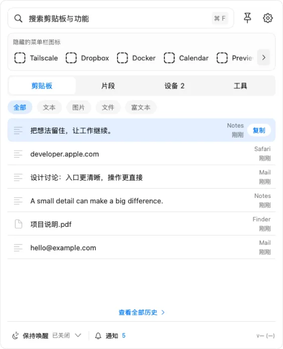
</td>
<td align="center" valign="top" width="50%">
<b>剪贴板历史</b><br /><sub>按类型、应用、日期筛选，完整预览</sub><br /><br />
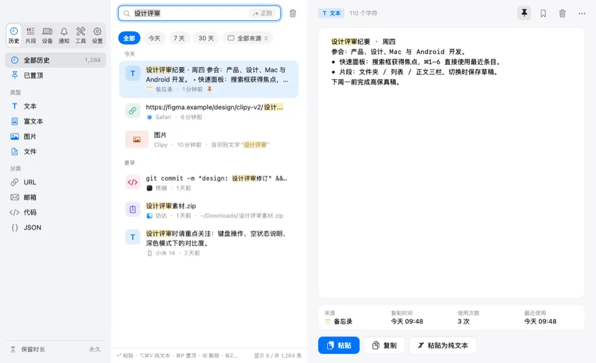
<br /><br />
<b>片段</b><br /><sub>文件夹、搜索与全局快捷键</sub><br /><br />
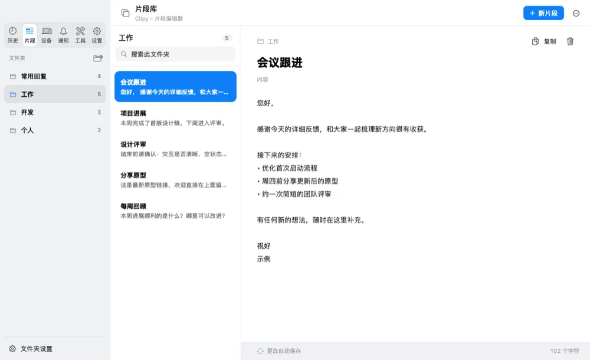
</td>
</tr>
<tr>
<td align="center" valign="top">
<b>截图与标注</b><br /><sub>可拖动控制岛，18 种标注工具</sub><br /><br />
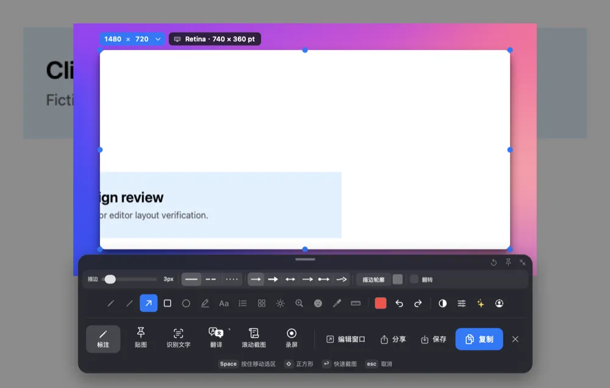
</td>
<td align="center" valign="top">
<b>文字与二维码识别</b><br /><sub>本机 OCR</sub><br /><br />
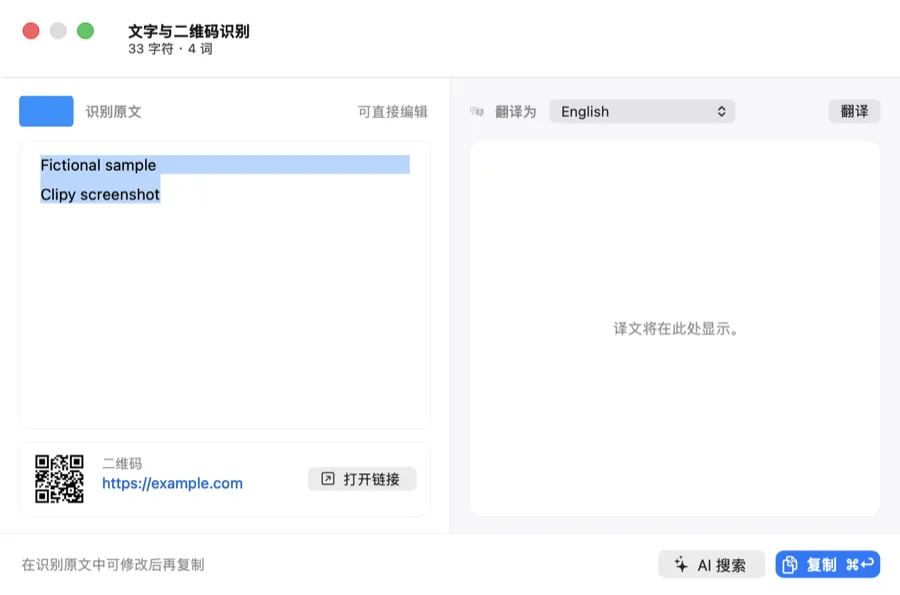
</td>
</tr>
<tr>
<td align="center" valign="top">
<b>设备</b><br /><sub>局域网发现，发送文本与文件</sub><br /><br />
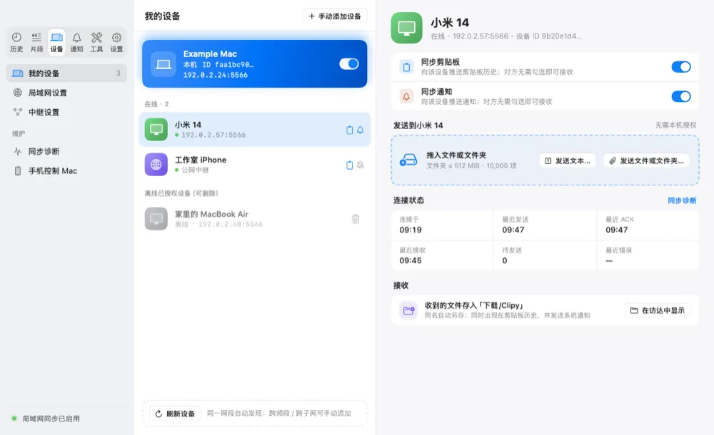
</td>
<td align="center" valign="top">
<b>手机通知</b><br /><sub>在 Mac 上查看 Android 通知</sub><br /><br />

</td>
</tr>
<tr>
<td align="center" valign="top">
<b>查词与单词本</b><br /><sub>查单词、翻译句子</sub><br /><br />
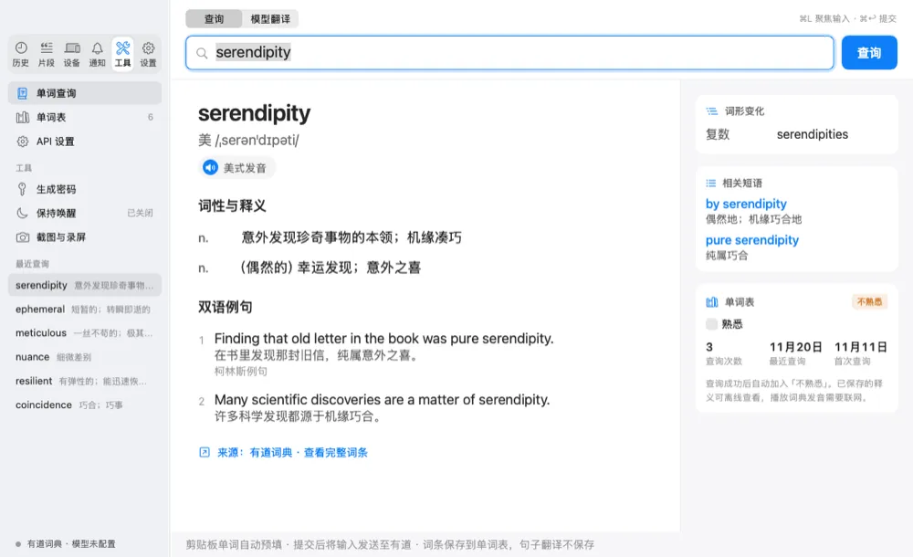
</td>
<td align="center" valign="top">
<b>保持唤醒</b><br /><sub>按时长阻止空闲休眠</sub><br /><br />
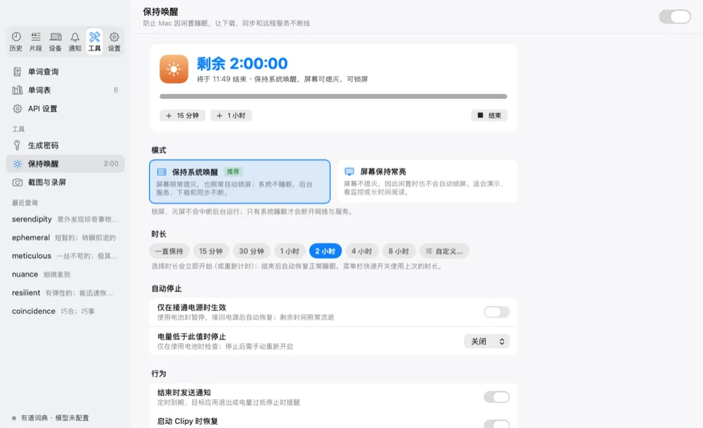
</td>
</tr>
</table>

## Android

<p align="center">
  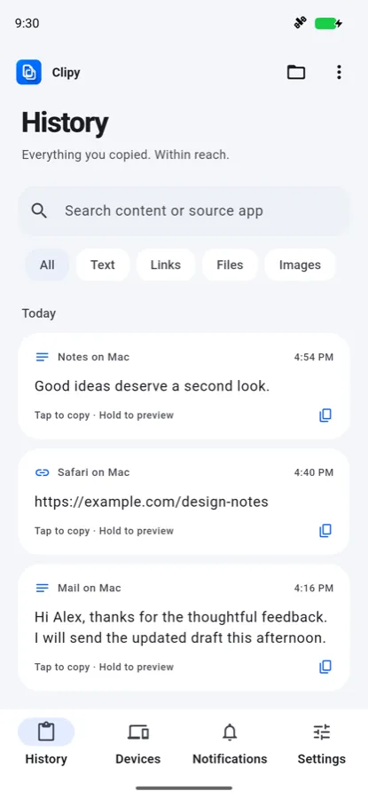&nbsp;&nbsp;
  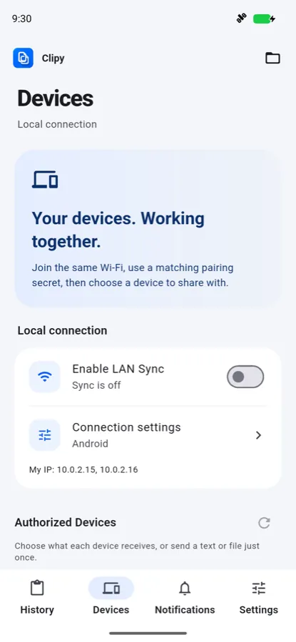&nbsp;&nbsp;
  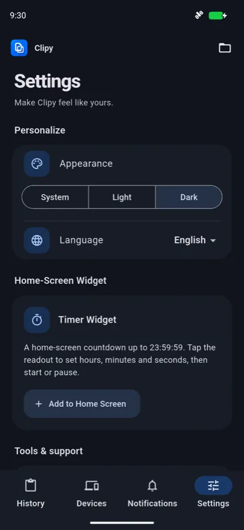
</p>
<p align="center"><sub>历史 · 设备 · 设置，另有通知转发与桌面倒计时部件（Android 截图为英文界面）</sub></p>

<sub>截图均使用虚构示例数据，展示当前源码版本；顶部为概念插画。[制作说明](res/screenshots/README.md)</sub>

## 平台

| | macOS | Windows | Android | iOS |
| --- | :---: | :---: | :---: | :---: |
| 剪贴板历史与搜索 | ✅ | ✅ | ✅ | ✅ |
| 局域网加密文本同步 | ✅ | ✅ | ✅ | 前台 |
| 文件传输 | ✅ | ✅ | ✅ | ✅ |
| 手机通知 | ✅ | 查看 | 转发 | 查看 |
| 片段与快捷键 | ✅ | | | |
| 截图、OCR、录屏 | ✅ | 截图 | | |
| 查词、保持唤醒 | ✅ | | | |
| 安装包 | ZIP | ZIP | APK | 仅源码 |

## 三步上手

1. **安装**：Mac 拖进「应用程序」，Windows 解压完整 ZIP，Android 安装 APK。
2. **复制**：Mac 上按 <kbd>⇧</kbd> <kbd>⌘</kbd> <kbd>F</kbd> 搜索历史。
3. **连接**：设备连同一个可信 Wi-Fi，刷新设备列表即可。

[反馈问题](https://github.com/JunWeiUp/Clipy/issues/new?template=bug_report.yml) · [功能建议](https://github.com/JunWeiUp/Clipy/issues/new?template=feature_request.yml)

> [!NOTE]
> 局域网同步面向可信网络。当前源码使用内置默认 AES-GCM 密钥，不能验证设备身份。详见 [SECURITY.md](SECURITY.md)。

当前源码版本：**1.0.44** · 源码构建号 **12404**（Android arm64 `versionCode` **14404**） · 最新正式版：**[v1.0.43](https://github.com/JunWeiUp/Clipy/releases/tag/v1.0.43)**

<details>
<summary><b>全部功能</b></summary>

- **历史**：macOS 记录文本、RTF、HTML、PDF、图片和文件，Windows 记录文本、图片和文件路径。重复内容会移到顶部。支持排除应用、设置保留时长，并可选加密媒体。
- **片段（Mac）**：文件夹、拖动排序、单条全局快捷键、XML 导入导出。
- **截图（Mac）**：区域、窗口、全屏、滚动长截图、录屏（MP4/GIF）。包含 18 种标注工具，以及美化、OCR、二维码、自动打码、翻译、贴图和编辑窗口。基于 [macshot](https://github.com/sw33tLie/macshot)。
- **搜索（Mac）**：<kbd>⇧</kbd> <kbd>⌘</kbd> <kbd>F</kbd>，支持正则，可按类型、应用、日期筛选。
- **查词（Mac）**：<kbd>⌃</kbd> <kbd>⌥</kbd> <kbd>D</kbd>。中英互查、句子翻译，可通过自有 API 使用模型翻译，单词本可离线复习。
- **同步**：局域网 AES-GCM 加密，通过 `/24` 扫描或手动 `IP:端口` 连接，带确认与离线队列。文本自动同步，文件需手动发送（单个最大 1 GiB，Mac 之间可传文件夹）。可选自建 [common-relay](https://github.com/JunWeiUp/common-relay) 中继，用于公网回退。
- **通知**：把选定的 Android 应用通知转发到桌面；macOS 上关闭通知会双向同步。
- **保持唤醒（Mac）**：可选系统或显示器模式，按时长保持或到指定应用退出为止；可设为仅接通电源时保持，退出应用即释放。
- **界面**：Mac 单一主窗口（<kbd>⌥</kbd> <kbd>⌘</kbd> <kbd>1</kbd>–<kbd>6</kbd> 切换），支持浅色/深色、中文/英文。Windows 常驻系统托盘。

</details>

<details>
<summary><b>从源码构建</b></summary>

**macOS**（Xcode 26+，部署目标 macOS 13）

```bash
./build_macos_app.sh                         # → clipy_macos/ClipyClone.app（ad-hoc 签名）
INSTALL_APP=1 LAUNCH_APP=1 ./build_macos_app.sh
```

**Android**（Flutter 3.41.7、JDK 17，需先配置发布密钥库）

```bash
./build_android_apk.sh                       # → dist/ClipyClone-Android-*.apk
```

**Windows**（Flutter 3.41.7 + Visual Studio C++ 工作负载）

```powershell
cd clipy_flutter
flutter pub get --enforce-lockfile
flutter build windows --release --no-pub -t lib/main_windows.dart
cd ..
./scripts/package_windows.ps1 -Version 1.0.44
```

**iOS**：iOS 15+ 目标在 CI 中做无签名构建；真机安装需要自行签名。

**检查**：运行 `bash scripts/check.sh all`；在 macOS 上还要运行 `bash scripts/test_macos_core.sh`。

版本号来自 [`clipy_flutter/pubspec.yaml`](clipy_flutter/pubspec.yaml) 中的 `version: X.Y.Z+N`，Android `versionCode` = N + 2000。推送新标签 `vX.Y.Z` 会发布包含三个安装包的版本。各版本变更见 [Releases](https://github.com/JunWeiUp/Clipy/releases)。

**目录**：`clipy_macos/` 是 Swift/AppKit 编写的 Mac 应用，`clipy_flutter/` 包含 Android、Windows 和 iOS 应用，`clipy_macos_nsh_experimental/` 是已暂停的实验（不参与构建），`packages/relay-swift/` 是中继依赖，`scripts/` 存放构建与检查工具。

</details>

## 参与贡献

欢迎用中文或英文提交 Issue 和 PR，参见 [CONTRIBUTING.md](CONTRIBUTING.md)。

## 许可证

Clipy 自有代码采用 [MIT](LICENSE)。macOS 应用包含修改过的 macshot 代码，按 [GPLv3](LICENSE.GPL-3.0) 分发；Android 和 Windows 版本不包含这部分代码。详见 [THIRD_PARTY_NOTICES.md](THIRD_PARTY_NOTICES.md)。

[](https://star-history.com/#JunWeiUp/Clipy&Date)
