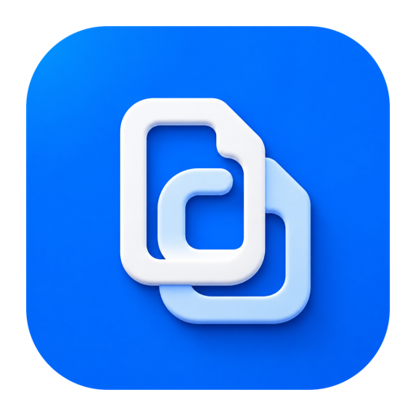
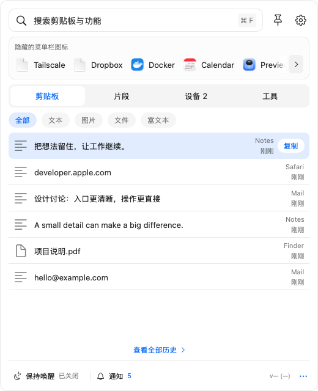
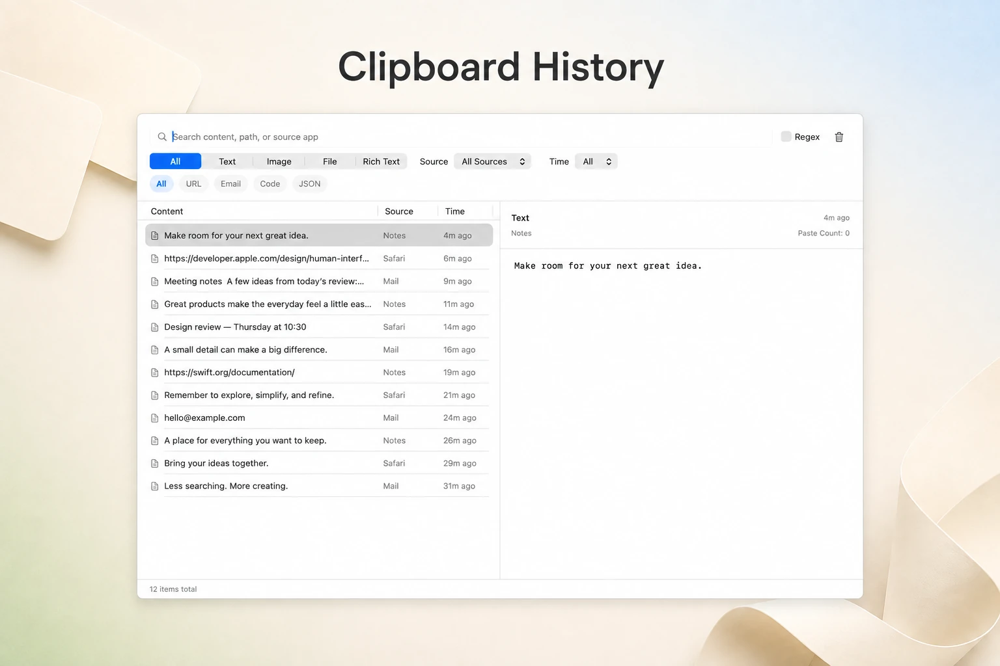
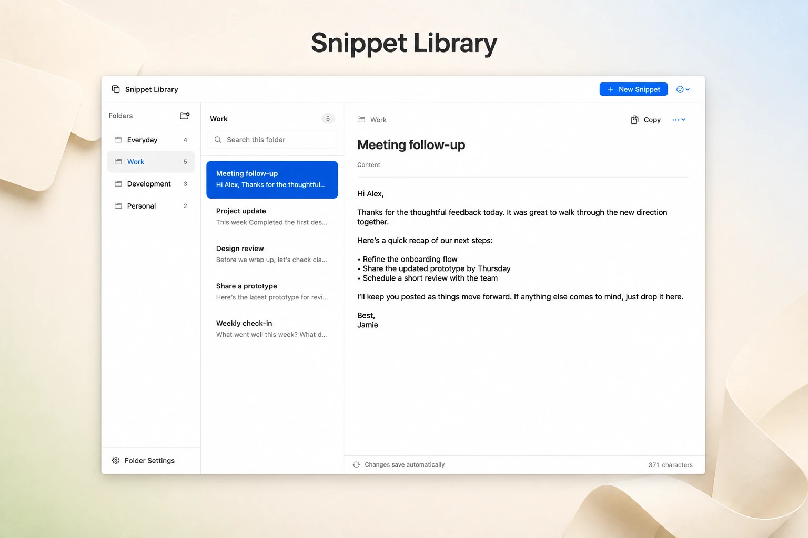
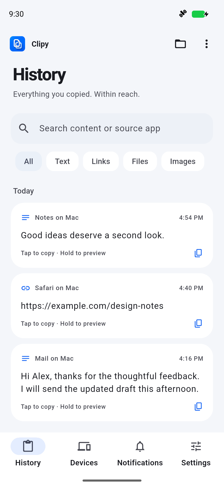
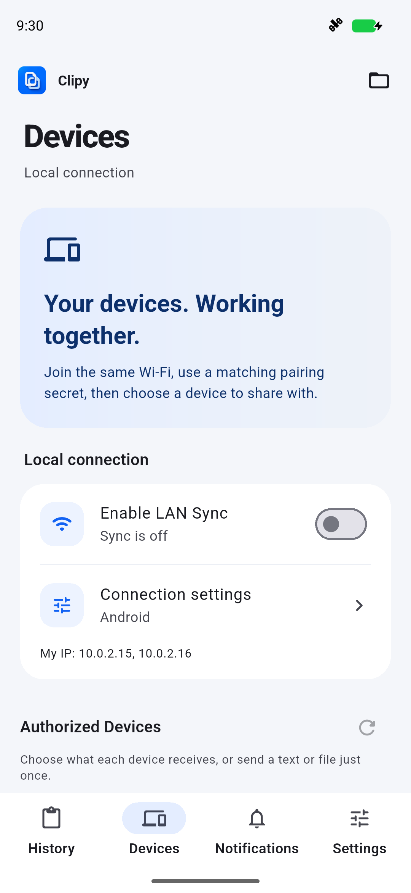
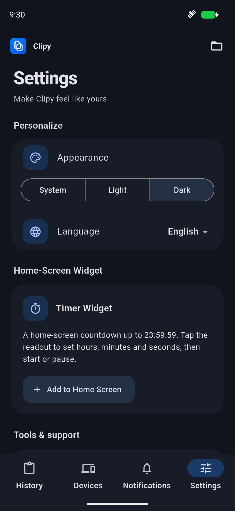
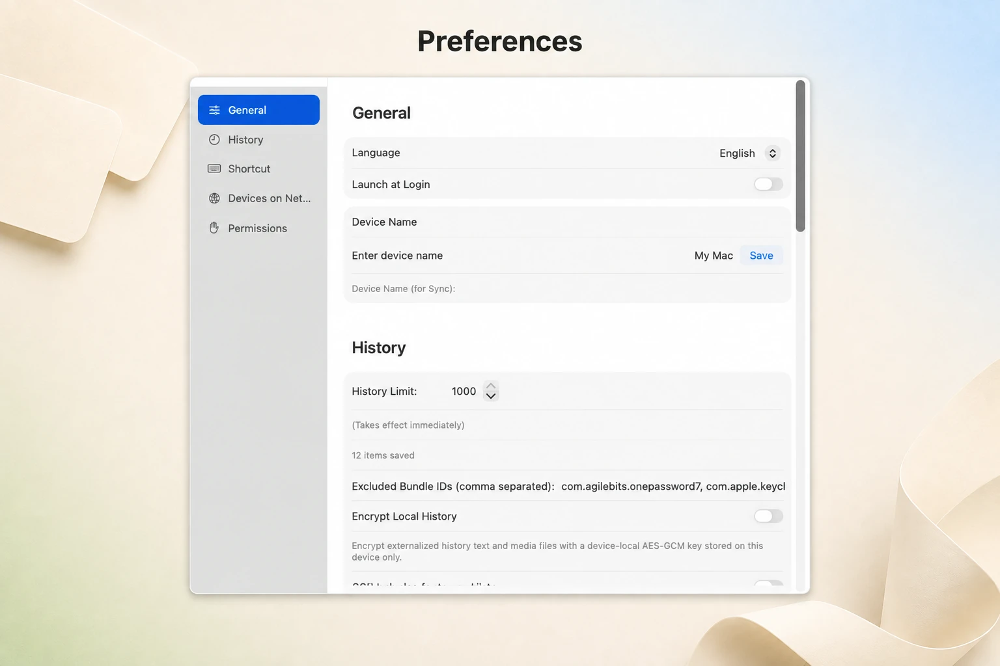

<div align="center">
  
  <h1>Clipy</h1>
  <h3>剪贴板历史、加密局域网同步、截图与 OCR。</h3>
  <p>面向 macOS、Windows 与 Android 的开源剪贴板管理器。</p>
  <p><a href="README.md">English</a> · <strong>简体中文</strong></p>
  
  <br /><br />

**[下载 macOS 版 ↗](https://github.com/JunWeiUp/Clipy/releases/latest)** &nbsp;&nbsp; · &nbsp;&nbsp; **[下载 Android 版 ↗](https://github.com/JunWeiUp/Clipy/releases/latest)** &nbsp;&nbsp; · &nbsp;&nbsp; **[下载 Windows 版 ↗](https://github.com/JunWeiUp/Clipy/releases/latest)**

<sub>上方下载入口指向最新正式版 · macOS 13+ / Apple Silicon · Windows 10/11 x64 · Android arm64 · <a href="docs/GETTING_STARTED_ZH.md#下载与版本">安装指南</a></sub>

[](https://github.com/JunWeiUp/Clipy/releases)
[](https://github.com/JunWeiUp/Clipy/actions/workflows/ci.yml)
[](LICENSE.GPL-3.0) [](LICENSE)

**[平台支持](#平台支持)** · **[看看界面](#从菜单栏开始)** · **[Android](#在-android-上也很顺手)** · **[开始使用](#三步开始使用)** · **[完整功能](#完整功能说明)**

</div>

Android 正式版与公共构建脚本使用 Flutter 版。原生 Kotlin/Compose 移植保留在 `clipy_android_native` 作为备选（[迁移与验收计划](docs/NATIVE_MIGRATION.md)），沿用相同包名、签名与数据文件，仅由 `./build_android_native_apk.sh` 构建。

<br />

**Clipy（ClipyClone）**是一款开源 **Clipboard Manager（剪贴板管理器）**，在本机保存复制历史，并为已连接的电脑与手机提供**跨设备剪贴板同步（Clipboard Sync）**和**局域网文件传输（LAN File Transfer）**。自动历史同步仅传输文本；图片和文件剪贴板条目保留在本机，发送文件需主动操作。同步使用 AES-GCM 加密，在可信局域网中完成，无需云端中转或注册账号。

Mac 原生菜单栏应用还集成了**截图标注、OCR 文字识别、屏幕录制、文本片段管理、词典与保持唤醒开关**；Windows 提供系统托盘入口，Android 支持通知镜像与倒计时桌面小部件。各平台可用功能如下。

<table>
<tr>
<td width="33%" valign="top">

### 剪贴板历史与搜索

保存复制过的文字、链接、图片与文件位置，随时搜索剪贴板历史。Mac 还支持全局搜索、内容类型和来源应用筛选，方便找回旧内容。

</td>
<td width="33%" valign="top">

### 跨设备同步与文件传输

在 macOS、Windows 与 Android 之间同步文本，或主动向已发现设备发送文件。当前源码采用默认加密，无需配对；自动同步由发送端共享开关控制。

</td>
<td width="33%" valign="top">

### 文本片段与全局快捷键

把常用回复、代码片段放进 Mac 片段库，按文件夹整理，配置键盘快捷键并直接搜索调用。片段库支持 XML 导入与导出。

</td>
</tr>
</table>

## 平台支持

| 平台 | 分发方式 | 可用功能 |
| --- | --- | --- |
| **macOS 13+ · Apple Silicon** | ZIP · Swift/AppKit 原生应用 | 剪贴板历史、片段、局域网同步、文件/文件夹传输、截图标注、OCR、录屏、Android 通知镜像与保持唤醒。 |
| **Windows 10/11 · x64** | 免安装 ZIP · Flutter + Win32 | 文字/图片/文件历史、搜索、系统托盘、文本同步、主动文件传输、区域/窗口/显示器截图与 Android 通知查看。 |
| **Android · arm64-v8a** | APK · Flutter + Kotlin | 剪贴板历史与搜索、文本同步、文件传输、通知转发与原生倒计时部件。剪贴板采集受 Android 前台访问规则限制。 |
| **iOS 15+** | 开发目标 · 暂无 IPA/TestFlight 发布包 | 历史查看、用户主动粘贴、前台局域网同步、文件传输与 Android 通知查看；CI 进行无签名构建和模拟器检查。 |

## 从菜单栏开始

### Mac 原生菜单栏剪贴板管理器

Mac 悬浮窗顶部就是搜索，下方依次是隐藏的菜单栏图标和最近复制。片段、工具与已连接设备也随手可达，无需让窗口常驻 Dock。

<p align="center"><a href="res/screenshots/macos-panel-zh.png"></a></p>

<table>
<tr>
<td width="50%" valign="top">

### 给剪贴板，多一点记忆。

按内容类型、来源应用和日期筛选，先看完整预览，再复制使用。

<a href="res/screenshots/macos-history-en.png"></a>

</td>
<td width="50%" valign="top">

### 写过的好内容，值得再用一次。

左边选文件夹，中间找片段，右边编辑正文。查找、修改和复制，在同一处完成。

<a href="res/screenshots/macos-snippets-en.png"></a>

</td>
</tr>
</table>

**看到的灵感，也能留下。** 在 Mac 上截图、标注、OCR 提取文字，或直接贴到屏幕上。还有滚动长截图、录屏和单词查询。[看看这些工具 ↓](#完整功能说明)

## 在 Android 上，也很顺手

通过 **历史 · 设备 · 通知 · 设置** 四个入口搜索剪贴板历史、配置局域网共享、发送文件，并向桌面端转发已授权的 Android 通知。还可从设置添加原生**倒计时桌面小部件**。支持浅色、深色和系统外观；短动效保留浏览位置，复制完成后给出明确反馈。

<p align="center">
  <a href="res/screenshots/android-history-en.png"></a>&nbsp;
  <a href="res/screenshots/android-devices-en.png"></a>&nbsp;
  <a href="res/screenshots/android-settings-dark-en.png"></a>
</p>

<sub>Mac 悬浮窗图片为使用虚构数据生成的源码构建原生截图；历史、片段和设置展示图经过装饰处理，点击可看原始捕获。Android 截图来自独立模拟器，顶部为概念插画。[图片来源与制作说明](res/screenshots/README.md)</sub>

<details>
<summary><b>再看一个细节：顺着浏览习惯的偏好设置</b></summary>

连续滚动浏览 Mac 设置，也可从侧边栏直接跳到对应分类。

<a href="res/screenshots/macos-preferences-en.png"></a>

</details>

## 三步开始使用

1. **安装 Clipy。** Mac 解压后移入「应用程序」，Windows 完整解压 ZIP，Android 安装 APK。Mac 端入口在菜单栏；Windows 关闭窗口后仍保留系统托盘入口。详见[安装指南](docs/GETTING_STARTED_ZH.md)与 [macOS 首次启动说明](docs/MACOS_INSTALL.md)。
2. **复制一段想留下的内容。** Android 首次测试时保持 Clipy 打开；在 Mac 上按 <kbd>⇧</kbd> <kbd>⌘</kbd> <kbd>F</kbd> 搜索历史。
3. **连接你的设备。** 连到同一个可信 Wi-Fi，刷新设备列表后直接发送，或开启自动共享。[按步骤连接](docs/GETTING_STARTED_ZH.md#连接-mac-与-android)。

**[安装与常见问题](docs/GETTING_STARTED_ZH.md)** · **[反馈问题](https://github.com/JunWeiUp/Clipy/issues/new?template=bug_report.yml)** · **[建议新功能](https://github.com/JunWeiUp/Clipy/issues/new?template=feature_request.yml)**

> **开始共享前：** 当前源码同步采用内置默认加密密钥，无需配对；适用于可信局域网，请了解[安全边界](SECURITY.md)。macOS 应用包含修改过的 macshot 截图模块，按 [GPLv3](LICENSE.GPL-3.0) 分发；[来源与源码获取方式](THIRD_PARTY_NOTICES.md)另见声明。

<details>
<summary><b>版本、下载与源码构建</b></summary>

当前源码版本：**1.0.33** · 源码构建号 **12286**（Android arm64 `versionCode` **14286**） · 最新正式版：**[v1.0.32](https://github.com/JunWeiUp/Clipy/releases/tag/v1.0.32)** · [构建版本配置](clipy_android/pubspec.yaml)

安装包请前往[最新正式版](https://github.com/JunWeiUp/Clipy/releases/latest)，具体应用版本和构建号以发布说明为准。Android 改版已在 v1.0.19 发布；后续开发期间，源码版本可能领先于公开安装包。Release 徽章只显示公开版本，不包含草稿。旧版升级请阅读[同步版本差异](docs/GETTING_STARTED_ZH.md#同步版本差异)。

</details>

## 完整功能说明

<details>
<summary><b>展开剪贴板、截图、同步与通知功能</b></summary>

### 📋 剪贴板历史与复制粘贴管理

- macOS 捕获**文本、RTF、HTML、PDF、图片与文件**；Windows 记录**文字、图片和文件位置**到本机历史。Android 剪贴板采集遵循系统的前台访问限制。
- **SHA-256 去重** —— 重复复制会把内容重新置顶，而不是重复堆积。
- **文件感知** —— 显示源文件路径，并支持在 Finder 中定位。
- 可按 bundle id **排除指定 App**（密码管理器、钥匙串等）。
- 历史条数可配，菜单按需加载，限制留在内存中的历史数据量。
- 历史媒体文件可选**静态加密**（密钥保存在仅所有者可读写的本地文件中，详见[安全说明](SECURITY.md)）。

### ✂️ 文本片段与代码片段管理（macOS）
- 用**文件夹**组织常用文本/代码，支持拖拽排序。
- 每个片段/文件夹可绑定**全局快捷键**，内置快捷键录入器。
- 片段库支持 **XML 导入/导出**。

### 📸 截图标注、OCR 文字识别与录屏（macOS）
- 捕获模式：**区域 / 窗口 / 全屏 / 滚动长截图 / 屏幕录制（MP4 + GIF）**。
- **18 工具标注引擎**（移植自 [macshot](https://github.com/sw33tLie/macshot)），统一单全屏 OverlayView：画笔（压感 + 平滑）、直线、**6 种箭头**（曲线/虚线/手绘）、矩形、填充矩形、椭圆、**正片叠底荧光笔**、富文本（粗体/斜体/描边/背景）、自增**编号**、emoji/图片**图章**、**马赛克/模糊/纯色/擦除**遮挡、**放大镜**、**像素标尺**、**取色器**、**聚光灯**。
- 每工具**二级选项条** + 玻璃主工具条 + 颜色/emoji/字体/特效弹层。
- **美化**渐变包裹 + **图像特效**（亮度/对比度/饱和度/锐度）。
- **滚动长截图**带侧边实时预览（基于 Vision 的帧拼接）。
- **录屏**含系统音频 + 麦克风双轨、摄像头悬浮窗、鼠标点击高亮、按键显示。
- 基于 Apple Vision 的**端侧 OCR** + **二维码**；**自动遮挡**敏感信息；**Apple Translation** 翻译覆盖。
- **贴图到屏幕**（缩放/透明度/旋转/编辑）、**右下角浮动缩略图**反馈、**独立编辑器**窗口（裁剪/翻转/缩放）、另存为、复制。
- 保存目录可配、单键工具快捷键、全局快捷键。
- 完整本地化（英文 + 简体中文）。

### 🔍 剪贴板全局搜索（macOS）
- 任意位置按 <kbd>⇧</kbd><kbd>⌘</kbd><kbd>F</kbd> 呼出。
- 支持**正则**，并可按**类型、来源 App、日期**筛选。
- 结果排序、多选、复制/粘贴，搜索结果中即可置顶。

### 📖 词典查询、翻译与单词本（macOS）
- 从剪贴板菜单栏进入，或按 <kbd>⌃</kbd><kbd>⌥</kbd><kbd>D</kbd> 打开；可在偏好设置中修改或关闭快捷键。
- 支持中文、英文及部分文字查询：中文查询列出英文译词，中英文联想与英文拼写建议可点击查看完整词条。英文词条包含中文释义、词性、美式音标、词形变化、相关短语与双语例句；点击短语可继续查询。
- 支持英文短语、整句译中文，以及中文句子译英文，允许标点和数字（最多 500 字符）。`Fine-grained personal` 等未收录短语会显示独立的机器翻译，支持复制译文和朗读英文。将内容粘贴到输入框后点击**查询**或按 <kbd>⌘</kbd> + <kbd>Return</kbd> 提交；句子翻译不加入单词表。
- 支持美式发音播放；词典音频不可用时使用已安装的系统美式英语语音。词典缺少音标、短语或例句时会明确提示。
- 打开窗口时，若剪贴板内容是单个英文单词，会自动填入并聚焦输入框，按回车即可查询；句子、网址、文件和多个单词不会自动填入。仅在确认提交后联网查询有道词典，完整词条自动保存到本机单词表；关闭窗口即取消请求、停止发音并释放结果。
- 从菜单栏或查词窗口打开**单词表**，在**不熟悉 / 熟悉**两个列表中复习；勾选即标记熟悉，取消勾选移回不熟悉。支持中英文模糊搜索（部分文字、跳字、混合关键词及英文拼写容错），覆盖单词、释义、词形、短语与例句；离线查看已保存的音标、释义、词形、短语与例句，联网播放词典发音（不可用时回退系统语音）。重复查询更新词条和查询次数，保留熟悉状态。单词表仅保存在这台 Mac，不参与同步；旧版本未保留查询记录，无法补回此前查过的单词。
- 单词表支持一键显示／隐藏中文释义，同时切换列表摘要、详情释义、短语翻译和例句翻译；会记住上次选择，关闭窗口或重启应用后仍然生效。独立查词窗口继续显示完整释义。
- 使用无需 API Key 的有道网页词典接口，非有版本保障的公开 API，接口可能变化或暂时不可用；结果附词典来源链接。

### 🔄 加密剪贴板同步与局域网文件传输

- macOS、Windows 与 Android 之间使用 **AES-GCM 256 位**加密传输；iOS 开发目标在前台时同步。
- 设备通过 **/24 子网扫描**和**手动 IP:端口**互相发现。跨子网连接需要路由可达、允许防火墙访问；无需云端中转或账号。
- 自动**文本剪贴板同步**带接收确认与离线队列。图片和文件剪贴板条目保留在本机；文件需从设备页或菜单主动发送。
- **手机系统分享入口**：Android、iPhone 分享任意格式文件时可选择 Clipy，确认文件清单、选择设备后点击发送。每次最多 32 个文件，**单文件上限 1 GiB**，并检查临时存储空间。iPhone 可直接在分享页查找、选择设备并发送，无需打开主 App。发送超过 512 MiB 的文件需要收发两端都更新；v1.0.29 已包含这些改动；iOS 需自行签名构建。
- **Android 文字分享（v1.0.32）**：其他应用分享的纯文字会显示原文预览，选择设备后直接作为文本发送，不生成 `.txt` 文件；真正的文本文件附件仍按文件传输。
- **Android 分享页设备发现**：优先复用连接、查找已记住的设备，必要时再扫描局域网；页面直接提供刷新进度及同步未开启提示。重复请求合并，扫描有范围上限和冷却时间，不新增后台轮询；发送成功后自动关闭分享页。
- **接收文件通知**：文件校验并保存成功后弹出通知，点击可在 Finder、Android 文件管理器或 Windows 资源管理器定位；iPhone 可直接预览或选择打开方式。需允许系统通知，Windows 需保持 Clipy 在托盘运行。
- **Mac 之间发送文件夹**：在设备菜单选择**发送文件或文件夹…**。新版 Mac 会自动还原到 `~/Downloads/Clipy/`，保留子目录、空目录及隐藏文件；同名时自动另存。两台 Mac 都需包含本次文件夹传输更新才能自动还原；旧版 Mac 和 Android 收到普通 ZIP。单次文件夹含打包开销上限为 **1 GiB / 10,000 个项目**（v1.0.29；旧版仍为 512 MiB）；符号链接及特殊文件会拒绝发送。
- 稳健可靠：**离线对端队列**会在设备短暂断网后自动重投。
- 通过内容哈希**防止环路**，复制内容不会在设备间无限弹跳。

### 🔔 Android 手机通知同步与桌面镜像

- 在 macOS 或 Windows 查看 Android 手机的通知；iOS 开发目标也支持只读查看。
- macOS 支持**双向关闭通知**与一键清除；通过 App **白名单**选择允许转发的 Android 通知。

### ☀️ 保持唤醒 / Keep Awake（macOS）

- 点击控制面板底部的**保持唤醒**按钮，在 Clipy 运行期间防止闲置导致的屏幕关闭和系统睡眠。按钮图标和文字显示当前状态，经典工具菜单也提供同一入口。
- 再次关闭或退出 Clipy 会释放唤醒请求。合盖和手动睡眠仍然有效；重启 Clipy 后保持唤醒默认关闭。

### macOS 界面
- **隐藏的菜单栏图标：** 在偏好设置 → 通用或浮层设置中开启。每个已连接屏幕上被挤掉的项目直接显示在搜索框下方的图标栏中，优先显示原图，截取失败时显示应用图标和名称。点击通过辅助功能请求打开原菜单，部分应用可能不支持；不移动图标。需要辅助功能权限；屏幕录制权限仅用于原图预览（macOS 14+），并非必需。不保证动态图标内容复现。
- 原生标题栏、清晰的浅色/深色内容背景，以及统一的 SF Symbols、间距与控件样式。
- 按 <kbd>Esc</kbd> 关闭当前聚焦的窗口，包括设置、搜索、查词、单词表、片段及图片／视频编辑器、OCR 结果和贴图；保留原有保存提示，输入法组词、快捷键录入和模态对话框优先处理取消操作。
- **轻量控制面板：** 左键点击菜单栏图标，打开原生浮层，顶部一行包含搜索、置顶和设置，下面是直出的隐藏图标、「剪贴板 / 片段 / 设备 / 工具」四个标签（设备页可刷新，每台设备直接提供「发送文本」「发送文件」），以及通知页面。详情页采用更小的返回／标题布局；工具页集中四个入口：截图模式直达、查词／单词本、生成密码；顶部隐藏图标栏和其他标签保持一致，切换工具时维持相同面板尺寸；底部保留保持唤醒与通知，通知弹出开关收进更多菜单。搜索异步覆盖历史、片段与工具，首页展示最近六条复制内容；点击历史行会复制并粘贴支持的文本类型，行内「复制」按钮只复制并保持浮层打开。可固定面板，点击外部不关闭；右键菜单栏图标仍可打开经典原生菜单。
- 偏好设置与截图设置可连续滚动浏览各类选项，侧边分类随滚动高亮，也支持点击跳转。界面开发规范见 [macOS 设计标准](docs/MACOS_DESIGN.md)。

### ⌨️ 全局快捷键 与 🌍 国际化
- 搜索、单词查询、截图、每个片段均可绑定快捷键。
- 中/英文界面；macOS 与 Android 源码采用原生实现，Windows 和 iOS 当前仍使用 Flutter。Windows 新增本机文字／图片／文件历史与系统托盘；iOS 支持用户主动粘贴及前台局域网同步，不能在后台持续读取其他应用的剪贴板或通知。CI 对 iOS 进行无签名构建，目前没有可安装的 iOS 发布包。

<details>
<summary><b>🔐 关于安全的说明</b></summary>

当前源码采用无需配对的协议 v3 和内置 AES-GCM 密钥。开启局域网同步、刷新设备即可主动发送文本和文件；只有自动共享需要开启发送端开关。两端都须使用 v3 构建；v1.0.25 及更早版本使用 v2。默认密钥不验证设备身份，也不能对已知密钥的局域网参与者提供保密性。完整说明见 [SECURITY.md](SECURITY.md)。
</details>

</details>

<details>
<summary><b>开发者文档：构建、架构与同步协议</b></summary>

## 🛠️ 从源码构建

以下命令均在仓库根目录执行。如果网络需要代理，请先启用自己的终端代理配置（已配置 `proxy` 命令的本机可先执行 `proxy`）；构建脚本本身不依赖特定代理命令。

macOS、Android 和 iOS 的应用图标使用同一份设计母版。更新各平台尺寸及 README 标志的方法见[图标资源与导出说明](assets/branding/README.md)。

### macOS（Swift / AppKit）

环境要求：**Xcode 26+** 和 macOS 26 SDK；应用最低部署版本仍为 macOS 13。

```bash
./build_macos_app.sh
```

产物为 `clipy_macos/ClipyClone.app` 和 `clipy_macos/ClipyClone.app.dSYM`，默认**不安装、不启动**。如需构建后安装到 `/Applications` 并自动启动，请先退出正在运行的 Clipy，再执行：

```bash
INSTALL_APP=1 LAUNCH_APP=1 ./build_macos_app.sh
```

本地 macOS 构建使用 ad-hoc 签名，不含 Developer ID 签名或公证。详见[构建与签名选项](docs/DEVELOPMENT.md#macos)。

**在 GitHub 打包：**打开 [Actions → macOS Build](https://github.com/JunWeiUp/Clipy/actions/workflows/macos.yml)，点击 **Run workflow**，即可单独构建 Mac 应用，无需签名密钥或 Android 配置。推送到 `main`/`master` 和提交涉及 macOS 的 PR 时，CI 也会调用同一 Mac 任务；发布检查仍覆盖所有平台。

Mac 任务成功后，从运行摘要下载 artifact（需登录 GitHub，保留 30 天），其中只包含 **Apple Silicon / macOS 13+** 应用 ZIP；运行摘要提供安装指南链接，打包步骤会输出 SHA-256 摘要。

这些是临时签名的开发构建，不代表已正式发布；首次打开的「**隐私与安全 → 仍要打开**」操作和更新后授权说明见[安装指南](docs/MACOS_INSTALL.md)。完成发布清单后，版本标签会触发三个平台的正式发布。

### Android（Flutter）

环境要求：Flutter **3.41.7**（见 `.fvmrc`）、JDK 17 与 Android SDK。

每台构建机器首次使用时，需按 [Android 签名指南](docs/DEVELOPMENT.md#android)配置固定发布密钥，使用 Git 忽略的 `clipy_android/android/key.properties` 或签名环境变量。配置完成后，直接运行：

```bash
./build_android_apk.sh
```

产物为 `dist/ClipyClone-Android-arm64-v8a-v<version>.apk` 和 `dist/ClipyClone-Android-armeabi-v7a-v<version>.apk`。脚本会解析锁定的依赖并使用已配置的密钥签名两个 Release APK；GitHub Release 只提供 arm64 APK。后续升级须保留同一份密钥，切勿提交签名文件或密码。

如果只需调试包，无需配置发布签名：

```bash
(
  cd clipy_android
  flutter pub get --enforce-lockfile
  flutter build apk --debug --no-pub
)
```

调试包位于 `clipy_android/build/app/outputs/flutter-apk/app-debug.apk`。调试包与发布包签名不同，不能假设可互相覆盖安装；如确需卸载重装，请先备份应用数据。

原生备选（相同包名与签名，不发布）：`./build_android_native_apk.sh` 用 JDK 17 与 Android SDK 36 构建 `clipy_android_native`，无需 Flutter。显式 `BUILD_NUMBER` 即实际 versionCode（默认源码 +2000）；只能覆盖更低的 versionCode，切回 Flutter 时同样使用更高的构建号。

### Windows（Flutter + Win32）

在 Windows 10/11 x64 上安装 Flutter **3.41.7** 和 Visual Studio 的「使用 C++ 的桌面开发」工作负载后构建：

```powershell
cd clipy_android
flutter pub get --enforce-lockfile
flutter build windows --release --no-pub -t lib/main_windows.dart
cd ..
./scripts/package_windows.ps1 -Version 1.0.33
```

产物为 `dist/ClipyClone-Windows-x64-v1.0.33.zip`。完整解压后运行 `ClipyClone.exe`；关闭主窗口后仍在系统托盘继续记录和同步，托盘菜单的「退出」才会结束进程。文字可向已授权设备自动同步；复制的图片和文件保留在本机历史，文件传输需显式发起。v1.0.24 在「历史记录」提供「截图」菜单，支持区域、窗口和显示器截图；完成后复制 PNG 并保存到本机历史。窗口截图使用 Windows `PrintWindow`：目标应用可能拒绝捕获，也可能返回空白画面，受保护或使用 GPU 绘制的内容尤其需要实机检查。设置中可按剪贴板来源程序名排除应用；能识别来源进程时默认排除常见密码管理器。v1.0.33 修复托盘、通知与截图提示中的中文乱码，保留 32 位剪贴板位图的透明度，其他程序短暂占用剪贴板时会重试，并拒绝读取异常位图以免越界。Windows 源码构建与正式版 ZIP 均未签名；公开版本以发布页为准。

### iOS（Flutter + Swift）

要签名构建并安装到连接的 iPhone，请参照[真机构建与安装指南](docs/DEVELOPMENT.md#install-on-a-connected-iphone)。
iOS 入口已适配场景生命周期，界面提供主动粘贴与前台同步的专属说明。

iOS 15+ 目标已纳入 CI 无签名构建，目前不提供 IPA 或 TestFlight 下载。支持查看本地历史、通过系统粘贴按钮主动导入文字、前台同步、文件收发及查看 Android 镜像通知。iOS 限制后台持续运行和读取其他应用通知；公开分发前仍需签名真机验证权限与同步。

Android、iOS 和 Windows 在设置底部显示版本号与构建号，macOS 在菜单栏悬浮窗右下角显示。
刷新设备时显示实际扫描进度及最终设备数量，优先尝试已保存与手动输入的地址；新版 Flutter
客户端会一致处理同时发起的连接，仍兼容旧版 v3 客户端。

### 版本号与检查

源码版本仍取自 [`clipy_android/pubspec.yaml`](clipy_android/pubspec.yaml) 的 `X.Y.Z+N`；它是共用版本元数据，不意味着构建依赖 Flutter。`APP_VERSION` 可覆盖 `X.Y.Z`。macOS 默认构建号为 `N`；Android 公共脚本默认实际 `versionCode = N + 2000`，延续旧 Flutter ARM64 分包的编号。原生各 ABI 包使用同一个实际构建号。

显式传入 Android `BUILD_NUMBER` 时，它就是**最终 versionCode**，不再追加 ABI 偏移。Release CI 中 Android 使用 `N + 工作流运行序号 + 2000`，macOS/Windows 使用 `N + 工作流运行序号`。覆盖升级 Android 时须保留签名，并选择高于手机已装 APK 的实际构建号（包括旧 Flutter 分包偏移）；默认值可能低于已装的 CI 或本地包。修改源码版本时同步更新**中英文 README**；本次迁移不修改已公开发布版本。

在仓库根目录运行 `bash scripts/check.sh all` 可执行质量检查。macOS 上还需运行 `bash scripts/test_macos_core.sh`，验证搜索、单词查询与 socket 回归用例；它使用临时测试程序，不安装或启动应用。

可选运行 `CLIPY_MENU_BAR_LIVE_TESTS=1 bash scripts/test_macos_core.sh`，在单个内置屏幕、已有辅助功能权限的环境中创建临时溢出图标，验证原生菜单和弹窗能否打开；不会安装应用或移动现有图标。

## 🏗️ 架构

**macOS 应用** —— Swift + AppKit，原生菜单栏应用（`LSUIElement`，不占 Dock）：
- `MenuController` —— 状态栏菜单：历史、片段、设备与各项操作。
- `Sources/MenuBarOverflow/` —— 可选的隐藏菜单栏项目发现、图标预览和辅助功能操作；仅本机使用，不调整图标顺序。
- `ClipboardManager` —— 剪贴板轮询、历史持久化、去重、同步分发。
- `SnippetManager` —— 文件夹、片段、快捷键、导入导出。
- `SyncManager` —— 子网/手动发现、带长度前缀的 TCP 同步（协议 v3）、AES-GCM 加密、可靠历史与通知投递。
- `Sources/Screenshot/` —— 完整的截图/录屏引擎（移植自 macshot）：统一 OverlayView、18 工具标注引擎、滚动长截图、录屏、美化/特效、OCR、贴图、浮动缩略图、编辑器窗口。由 `ScreenshotSessionCoordinator` 编排。
- `SearchWindow` —— 带筛选与排序的全局搜索。
- `NotificationManager` —— 手机通知镜像。
- `PreferencesManager`、`SettingsWindow`、`SnippetEditorWindow`、`LogWindow` —— 配置与编辑界面。

**Android 应用** —— Flutter（`clipy_android`）配合 Kotlin 平台通道、前台服务、通知监听与倒计时部件。原生 Kotlin/Compose 备选实现（`clipy_android_native`）沿用相同数据契约、包名与密钥，但不用于正式发布。

**Windows/iOS 应用与 Android 对照参考** —— Flutter/Dart：
- `lib/main.dart` —— 默认入口；`lib/app/` 负责初始化与无界面引擎桥接。
- `lib/features/` —— 设备、历史、设置、日志与文件页面。
- `lib/clipboard_manager.dart` —— 剪贴板监听、历史、同步协调。
- `lib/sync_manager.dart` —— 子网/手动发现、TCP 同步 v3、加密、历史与通知投递。
- `lib/notification_manager.dart` —— `NotificationListenerService` 集成。

## 🔁 同步协议

Clipy 使用面向局域网的协议 v3 处理剪贴板历史与通知：

- **设备发现** —— `/24` TCP 端口扫描 + 手动 `IP:端口`（可跨子网 / 双频段）。
- **传输方式** —— 原生 TCP，每条 JSON 信封带 4 字节大端长度前缀（`v: 3`，单帧上限 2 MB）。
- **消息类型** —— `history`、`history.fetch`、`notif.post` / `dismiss` / `clear` / `ack`、`hello` / `welcome`、`ping` / `pong`、`ack`。
- **加密** —— AES-GCM 256 位（当前源码使用内置默认密钥）。
- **授权** —— 仅向本机授权列表中的设备推送剪贴板/通知。
- **可靠投递** —— 历史帧需在落库成功后 `ack`；有界离线队列 + 端点缓存用于重连。
- **环路防止** —— 内容哈希避免重复广播。

完整线协议、无 UI 保活通道规则与代码地图见 [`docs/PROTOCOL.md`](docs/PROTOCOL.md)。

当前源码新增可选的[自托管公网中继](docs/COMMON-RELAY-SDK.md)：优先局域网直连，不可用时通过带访问密钥的 WSS 中继传输文字、通知和文件。公网中继为每台设备登记独立身份并核对对端公钥；局域网发送仍无需配对。iOS 原生分享扩展仍仅支持局域网。已随 v1.0.32 发布，需要兼容的 common-relay 服务。

## 📁 项目结构

```
clipy_macos/Sources/      # macOS Swift/AppKit 源码
clipy_android/lib/        # Android、Windows 与 iOS 的 Flutter/Dart 源码
clipy_android_native/     # 原生 Kotlin/Compose Android 备选实现（不发布）
build_macos_app.sh        # macOS 应用包构建脚本
build_android_apk.sh      # Android 分 ABI APK 构建脚本
.github/workflows/        # CI + 三平台正式发布
res/                      # README 图片资源
assets/                   # Logo 与应用图标
```

</details>

## 🤝 贡献

欢迎用中文或英文提交 Issue 和 Pull Request！先阅读[贡献规范](CONTRIBUTING.md)、[架构地图](docs/ARCHITECTURE.md)与[修改指引](docs/AI_CHANGE_GUIDE.md)。贡献代码：

1. Fork 仓库并创建功能分支。
2. 运行 `bash scripts/check.sh all`，并构建受影响的原生平台。
3. 提交 Pull Request 描述你的改动。

## 📦 发布

完成[发布清单](docs/DEVELOPMENT.md#release-checklist)、配置发布签名并更新 `clipy_android/pubspec.yaml` 和中英文 README 后提交改动，再推送与源码版本一致的**全新、未使用过的版本标签**。所有检查通过后，工作流会直接发布正式版：

```bash
VERSION="$(awk '/^version:/ {split($2, v, "+"); print v[1]; exit}' clipy_android/pubspec.yaml)"
git tag "v${VERSION}"
git push origin "v${VERSION}"
```

也可以手动触发 `Release` workflow，并输入与源码一致的 `X.Y.Z` 版本号。两种触发方式都会直接公开发布，请提前完成清单；不要移动或覆盖已有版本标签。

工作流发布正式最新版，只上传三个安装包：macOS ZIP、Android arm64 APK 和 Windows x64 ZIP。GitHub 在每个附件旁显示 SHA-256 摘要，不再单独上传校验清单、符号包、许可或声明文件；macOS 应用内附 MIT、GPLv3 全文与第三方声明，Windows ZIP 内附适用的 MIT 文本与声明。GitHub 另行自动生成源码压缩包。发布后检查附件链接，并同步更新中英文 README 和两份入门指南中的已发布版本。详见 [GitHub 发布说明](https://docs.github.com/en/repositories/releasing-projects-on-github/managing-releases-in-a-repository)。

可使用[更新说明模板](docs/RELEASE_NOTES_TEMPLATE.md)，说明用户可见的变化、升级步骤与实际提供的平台版本。

## 📄 许可证

Clipy 自有代码仍采用 [MIT](LICENSE)。macOS 组合应用包含修改过的 macshot 代码，按 [GNU GPLv3](LICENSE.GPL-3.0) 分发；Android 与 Windows 不包含 macshot。详见[来源、修改说明与源码获取方式](THIRD_PARTY_NOTICES.md)。

## ⭐ Star History

[](https://star-history.com/#JunWeiUp/Clipy&Date)

---

<div align="center">

如果 Clipy 帮到了你，欢迎给个 ⭐ —— 这能让更多人发现这个项目！

</div>

[Common Relay SDK upgrade / 通用中继 SDK 升级](docs/COMMON-RELAY-SDK.md)

1.0.32：公网中继设置新增 **管理公网设备组**，支持查看在线/离线成员、二维码或链接邀请、批准加入与移除设备。需要兼容的 common-relay 服务，创建新组需服务端开启自助创建；详见 [中继 SDK 与设备组](docs/COMMON-RELAY-SDK.md)。已有旧组可通过可信管理员邀请启用管理。


公网设备组支持直接创建新组或通过二维码加入。创建者可邀请、查看和移除设备；邀请、配对审批与成员列表分区展示。已接入的旧组保留原配置，可通过管理员邀请升级管理信任。

设备组支持修改设备名称、退出当前组及管理员解散整个组；操作前会说明影响范围并确认。退出保留本机历史与局域网配置。

公网中继邀请默认“扫码后自动加入”，可关闭并使用配对码手动确认。自动加入通过管理员签署的限时委托验证，仅授予普通成员权限，不要求邀请设备持续在线。二维码和复制链接使用加密邀请短链接，兼容旧邀请；既有成员须升级支持委托签名链的 SDK。服务端需支持自动入组及短链接接口。

切网与设备扫描现会在约 3 秒内检查旧连接，失效后立即触发中继接管；健康的局域网连接仍优先。3 秒为连接检查时限，不代表端到端连接必定在 3 秒内完成。
